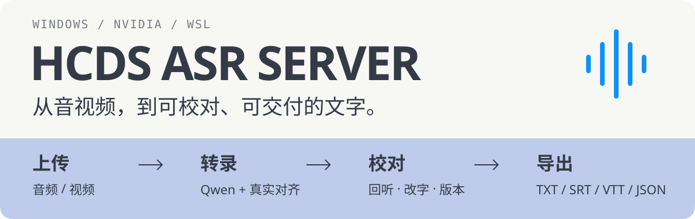
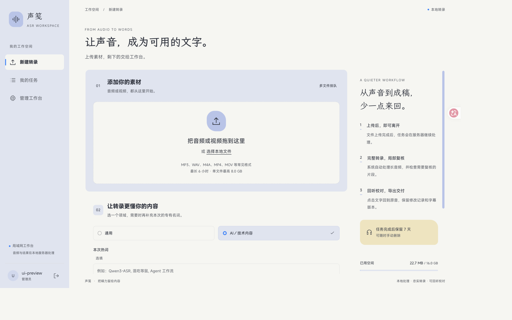
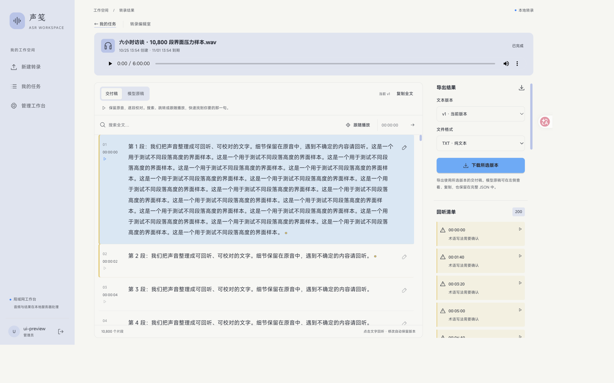
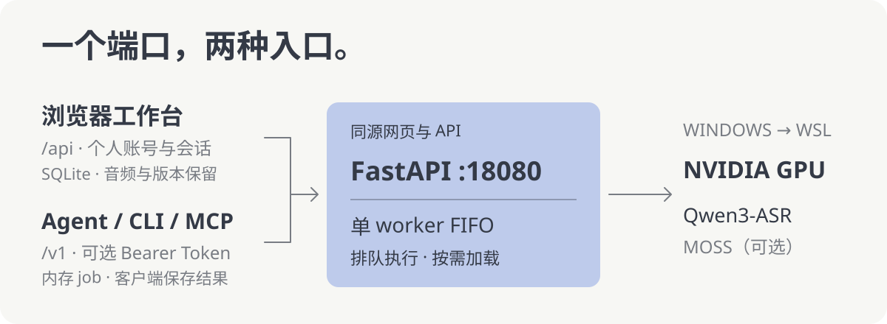

<p align="center">
  
</p>

# LAN ASR Server

**用浏览器把音视频变成可校对的文字与字幕，也让局域网里的 Agent 共用同一台 GPU。**

模型在 Windows 的 WSL 中运行，音频与工作台数据保存在自己的服务器。客户端通过网页、HTTP 或本地 MCP bridge 使用，无需安装 CUDA 或下载模型。

[工作台](#使用工作台) · [长转录编辑](#长转录也保持一屏工作区) · [部署](#首次部署) · [官方 Skill](#官方-skill从服务读取用法) · [Agent 接入](#接入-agent) · [验证边界](#验证与边界)



<sub>2026-10-25 新版工作台的本地浏览器截图，使用独立测试账号。[手机长转录预览](docs/validation-artifacts/2026-10-25-workbench-ui/mobile-final.png) · [界面与发布验收](docs/validation-2026-10-25-workbench-ui.md)。测试素材用于验证界面，不作为识别质量证据。</sub>

## 使用工作台

服务已部署时，打开 `http://YOUR_WINDOWS_LAN_IP:18080/`，用管理员分配的账号登录。

1. **上传**：拖入音频或视频，可多选文件逐个上传。上传中断后，重新选择同一文件即可续传。
2. **转录**：选择内容领域、填写本次热词。素材上传完成并加入队列后，可以关闭网页，在「我的任务」回来查看结果。
3. **校对**：搜索片段、按时间跳转或跟随播放回听。支持强制对齐的 Qwen 结果可修改文字并保留版本，服务只重新对齐受影响片段。
4. **交付**：导出 **TXT / SRT / VTT / JSON**。Qwen 字幕需该版本完成真实对齐；MOSS 使用经过检查的模型段级时间导出字幕。也可选择此前可导出的版本。

工作台默认使用 **Qwen3-ASR 1.7B + 官方 ForcedAligner**，按任务冻结公共词库和本次热词。只自动规范人工确认的无歧义别名，保留模型原稿、改词记录与待复核区间。

单文件默认上限 **8 GiB / 6 小时**，任务终态后保留 **7 天**，可提前删除。视频处理后保留可回听的音轨。**六小时是输入上限；当前 `quality_v1` 仍在试运行，六小时真实录音质量尚未验收。** 需要匿名说话人分段时，可在「更多设置」选择已启用的 MOSS，也可通过 [Agent 接口](#接入-agent)调用；可选模型和能力以服务返回为准。

### 长转录也保持一屏工作区

播放器和正文工具栏固定可用，正文、导出与复核工具各自滚动。长音频不会把整个结果页撑成一条长页面。

- **快速定位**：搜索全文片段并高亮匹配；输入秒数、`分:秒`或`时:分:秒`跳转到原音。
- **回听不丢位置**：可开启播放跟随；手动滚动正文时暂停跟随，方便停下来校对。
- **大量片段仍可操作**：动态高度虚拟列表仅渲染视口附近的片段，复核与修改记录分页；复制和导出始终使用完整文本。
- **手机可用**：在正文和「导出与复核」之间切换，播放器保持可见。



<sub>构造的六小时时间轴、10,800 段界面压力样本。打开时仅挂载 8 段；搜索、跳转至 05:59:50、编辑后保留原稿和全文导出均通过。任务详情仍读取完整正文，虚拟列表减少的是 DOM 与布局量。</sub>

界面采用 **HCDS 主题**：雾蓝 `#BECBEB`、卡布里蓝 `#0C91FA`、麦黄 `#EBCB75`、墨灰 `#343A46` 与纸白 `#F7F7F4`。**GSAP** 用于页面切换、面板与编辑浮层动效，遵循系统「减少动态效果」设置；字体提供本地回退，不依赖外部字体 CDN。

## 怎么工作

<p align="center">
  
</p>

网页与 API 共用 **`18080`**，真实转录按 FIFO 排队执行。模型按需加载，默认空闲 180 秒后卸载；进度报告服务端阶段与已完成分块。工作台有独立账号、任务归属和持久化数据，`/v1` 保持原有调用与内存 job 语义。

## 首次部署

已实机验证 **WSL2 Arch Linux + RTX 5070 Ti 16GB**。先按 [WSL 部署指南](docs/wsl-deployment.md)准备 Windows 驱动、WSL2、systemd、mirrored networking 与防火墙，仅开放 LAN 端口 `18080`。其他显卡和发行版需要各自通过 CUDA 与模型验收。

以下为 **WSL Linux 文件系统内的首次安装**。已有服务升级见[发布、备份与回滚](docs/product-workbench.md#发布与回滚)；无 GPU 开发机见[本地开发](#本地开发)。

### 1. 安装服务与网页

准备 Git、uv、Node.js 22.12+ 和 npm。Arch 系统依赖由部署脚本安装；Ubuntu 依赖准备见部署指南。

```bash
mkdir -p ~/services
git clone https://github.com/JinghaoHCDS/asr_Server.git ~/services/asr-server
cd ~/services/asr-server

npm --prefix frontend ci
npm --prefix frontend run build
bash deploy/wsl-deploy.sh --smoke-audio test-fixtures/audio/test_short.wav
```

部署脚本负责 Python 3.12、指定官方 CUDA wheel、模型运行依赖与隔离的质量流程语音检测模型，执行 CUDA、Qwen 独立转录和 HTTP 检查，再启动 systemd user service。

前端构建需单独执行；运行时由 FastAPI 提供 `frontend/dist`，无需常驻 Node 服务。首次使用会下载依赖与模型，离线运行前需先缓存并验证所需模型。

### 2. 启用真实对齐，创建账号

工作台需要真实时间戳。部署脚本默认关闭对齐，先运行独立验收：

```bash
.venv/bin/python scripts/qwen_forced_alignment_smoke.py \
  --asr-model Qwen/Qwen3-ASR-1.7B-hf \
  --audio test-fixtures/audio/test_short.wav
```

通过后，首次用 `cp -n .env.example .env` 创建配置，在 `.env` 中确认：

```dotenv
ASR_ADAPTER=qwen
ASR_ENABLE_QWEN_ALIGNMENT=1
ASR_WORKBENCH_ENABLED=1
ASR_WORKBENCH_DATA_DIR=data/workbench
```

创建首个管理员，按提示输入密码，再重启服务读取配置：

```bash
.venv/bin/python -m scripts.workbench_admin create admin \
  --data-dir "$PWD/data/workbench"
systemctl --user restart asr-server.service
```

没有默认账号密码。若修改数据目录，CLI 的 `--data-dir` 必须指向服务实际使用的目录；CLI 不会自动读取 `.env`。管理员登录后可创建或停用账号、重置密码、维护词库并查看队列与容量。

### 3. 完成第一条转录

在客户端替换服务器的 Windows 局域网 IP：

```bash
ASR_URL="http://YOUR_WINDOWS_LAN_IP:18080"
curl --noproxy '*' -fsS "$ASR_URL/health"
curl --noproxy '*' -fsS "$ASR_URL/v1/models"
```

打开同一地址的 `/`，登录并上传一段音频，在结果页回听、校对和导出。`/docs` 提供交互式 API 文档；服务器本机可用 `http://127.0.0.1:18080`。若已启用 `ASR_API_TOKEN`，访问 `/v1/**` 需携带 Bearer Token。

## 接入 Agent

### 官方 Skill：从服务读取用法

**官方 Skill：[仓库文件](skills/lan-asr/SKILL.md)，部署后可直接请求 `GET /skill`。**
Agent 先读取服务自身的使用指南，再用 `/openapi.json` 获取接口结构、
`/v1/models` 发现实际能力。`/docs` 也提供 Skill 入口。

| 地址 | 用途 |
| --- | --- |
| `/skill` | Markdown 使用指南，覆盖鉴权、模型选择、转录、对齐、说话人分段、轮询、恢复和取消 |
| `/skill/lan-asr.zip` | 完整 Skill、Python 批量客户端及自动填入部署地址的 `server.json`，供安装到其他 Agent |
| `/skill/asr_batch.py` | 同版本批量客户端源文件 |

`/docs` 的初始 HTML 和 `/openapi.json` 的描述都链接到 `/skill`，
Agent 无需执行网页 JavaScript 即可发现入口。这些文档端点公开可读；
实际 `/v1/**` 请求仍遵循服务的 Bearer 鉴权配置。

```bash
curl --noproxy '*' -fsS "$ASR_URL/skill"
# 完整下载包同时包含指南与 Python 批量客户端
curl --noproxy '*' -fS "$ASR_URL/skill/lan-asr.zip" -o lan-asr.zip
```

把包内 `lan-asr/` 放入所用 Agent 的 Skill 目录即可；已有共享安装使用
`~/.Agent/skills/lan-asr/`。**保留包内 `server.json`，下载后即可自动连接对应部署，无需手填 IP。**
先检查文件，升级时保留
`~/.Agent/state/lan-asr/` 中的批次数据库。仓库用户也可直接复制
`skills/lan-asr/`。客户端使用 Python 3.12+ 标准库，通过 `ASR_BASE_URL`
或 `--base-url` 覆盖服务器；也可把 `base_url` 保存在本地
`~/.Agent/state/lan-asr/config.json` 作为没有随包地址时的默认值。
优先级为命令行、环境变量、随包地址、本机默认值、loopback。HTTP 文档中的 Skill 与下载包同源，
服务会额外注入本部署地址；仓库模板不包含个人 IP。

默认使用实际下载网址生成随包地址，兼容 WSL mirrored/NAT 下的客户端访问入口。
需要固定公布地址时，在部署配置中设置 `ASR_PUBLIC_BASE_URL=http://YOUR_WINDOWS_LAN_IP:18080`，
或使用部署参数 `--public-base-url`；项目 `.env` 的设置优先于生成的 service unit。
空值、loopback 或通配监听地址会回退到实际下载网址。IP 改变后重新下载包或显式覆盖即可。

**先读 `GET /v1/models`，再选择当前服务声明的模型与能力。** 真实后端为 Hugging Face `transformers`，MOSS 和 Qwen 对齐需分别验收并启用。

| 用途 | 选择 |
| --- | --- |
| 语音、口播、课程转录 | `qwen3-asr-1.7b`（默认），支持 Context / 热词 |
| 轻量转录、首次后端验收 | `qwen3-asr-0.6b` |
| 字词定位、字幕、口播分析 | Qwen + 官方 ForcedAligner |
| 多人播客、访谈说话人分段 | `moss-transcribe-diarize-0.9b`（可选） |

### HTTP：上传、轮询、取结果

以下沿用前面的 `ASR_URL`。短音频可直接转录：

```bash
curl --noproxy '*' -fsS "$ASR_URL/v1/audio/transcriptions" \
  -F 'file=@audio.wav' -F 'model=qwen3-asr-1.7b' -F 'language=auto'
```

同步成功读取 `text`；长音频可能返回 `202` 异步任务。长素材建议显式创建 job：

```bash
curl --noproxy '*' -fsS "$ASR_URL/v1/audio/transcription-jobs" \
  -F 'file=@lecture.m4a' -F 'model=qwen3-asr-1.7b'

# 将 JOB_ID 替换为创建响应的 id，低频轮询
curl --noproxy '*' -fsS "$ASR_URL/v1/jobs/JOB_ID?detail=compact"

# status 为 completed 后，取一次完整结果
curl --noproxy '*' -fsS "$ASR_URL/v1/jobs/JOB_ID?detail=full"
```

最终正文为 `result.text`，已完成分块的临时文字不替代最终结果。`DELETE /v1/jobs/{id}` 请求安全取消，等待当前模型调用到达安全边界。

`/v1/**` 默认 `quality_profile=legacy`；Qwen 请求可显式传 `quality_profile=quality_v1`，但任务仍按 `/v1` 的内存语义管理。完整参数、生命周期与错误信封见 [API 合约](docs/asr-server-prd.md)和[工作台扩展](docs/product-workbench.md)。

### MCP：在客户端提供八个工具

本地 stdio bridge 提供模型发现、状态查询、转录、job 创建／查询／取消、模型加载／卸载。模型仍在 WSL 中运行。

<details>
<summary><strong>配置 MCP Host</strong></summary>

在客户端仓库目录运行 `uv sync --locked --extra mcp`，按 Host 支持的配置格式填写：

```json
{
  "mcpServers": {
    "lan-asr": {
      "command": "uv",
      "args": [
        "run", "--directory", "/path/to/asr_Server",
        "--extra", "mcp", "python", "-m", "asr_mcp.server"
      ],
      "env": {
        "ASR_MCP_BASE_URL": "http://YOUR_WINDOWS_LAN_IP:18080",
        "ASR_MCP_ALLOWED_ROOTS": "/path/to/audio"
      }
    }
  }
}
```

替换仓库路径、Windows IP 和允许读取音频的本地目录。服务启用 Bearer 鉴权时，在 `env` 中增加 `ASR_MCP_TOKEN`。多个允许目录在 POSIX 系统用 `:` 分隔，原生 Windows 用 `;`，JSON 中反斜杠需转义。详见 [MCP 指南](docs/mcp-bridge.md)。

</details>

### CLI：播客与批量交接

已启用 MOSS 时，CLI 可按用途选择服务端声明的说话人模型：

```bash
uv run python scripts/asr_client.py --base-url "$ASR_URL" \
  job /path/to/podcast.m4a --purpose podcast --poll-seconds 30

uv run python scripts/batch_transcribe.py batch.json \
  --output output --base-url "$ASR_URL" --max-in-flight 4
```

批量客户端支持逐素材 Context / 热词、本地缓存和失败恢复，生成可直接交接的结果目录：

```text
output/
├── index.md                 # 素材索引
├── manifest.json            # 来源、状态与恢复信息
└── items/<素材ID-内容hash>/
    ├── transcript.md        # 可读转录稿
    └── transcript.json      # 文字、时间、说话人与诊断信息
```

[查看合成输出样例](examples/output-sample/index.md) · [批量清单、口播与播客完整工作流](docs/batch-workflow.md)。`max-in-flight` 控制客户端在途任务数，服务端真实推理仍串行执行。

## 数据与配置

| 行为 | 网页工作台 `/api/**` | Agent API `/v1/**` |
| --- | --- | --- |
| 认证 | 个人账号、HttpOnly 会话、任务归属检查 | 可选 Bearer Token |
| 默认流程 | Qwen `quality_v1` | `legacy` |
| 任务与恢复 | SQLite；恢复队列与匹配的分块检查点 | 内存 job；重启后需重新提交 |
| 保存时间 | 终态后默认 7 天，可手动删除 | 内存结果默认保留 3600 秒 |
| 上传上限 | 单文件 8 GiB | 单文件 512 MiB |
| 保留区配额 | 每用户 16 GiB、全局 64 GiB | 上传与推理临时文件用后清理 |

工作台只允许普通用户访问自己的任务。删除覆盖音频、检查点与全部编辑版本。恢复时核对原音、模型、流程、词库和参数；不匹配则拒绝混用旧检查点，未完成的模型调用需重做。两条路径的推理临时文件均及时清理。

配置从 [.env.example](.env.example)开始。systemd 自动读取项目 `.env`；直接启动 Uvicorn 需显式设置环境变量或传 `--env-file .env`。代码默认 `ASR_ADAPTER=mock`，真实部署使用 `qwen`。对齐与 MOSS 默认关闭，独立验收后再启用。

设置 `ASR_API_TOKEN` 后，HTTP 请求携带 `Authorization: Bearer <token>`；CLI / batch 使用 `ASR_TOKEN`，MCP 使用 `ASR_MCP_TOKEN`。`/health` 和文档保持公开。**Bearer Token 不赋予个人工作台任务的访问权。** 工作台保留与配额配置、离线备份及回滚命令见[工作台契约](docs/product-workbench.md)。

## 验证与边界

**`quality_v1` 返回 `validated=false`，真实长音频质量仍待验收。** 流程完整覆盖原音，单块最多 180 秒，默认生成预算 4096，并对疑似问题作有界复核。当前默认 60 秒切分尚未被证明最优。

2026-10-25 本轮修复与界面更新的验证范围：

| 验证 | 已取得的证据 |
| --- | --- |
| 本地工程 | 393 项测试通过、4 项跳过；mypy 116 个文件、前端生产构建及依赖检查通过 |
| WSL 线上行为 | 17 项产品回归与 46 项三模型检查通过，覆盖取消／删除清理、字幕导出、编辑对齐、静音、损坏音频、生成截断和模型卸载 |
| 模型推理实践 | Qwen 使用官方 native helpers；MOSS 真实 CUDA 探针确认语音与文本注意力模块均使用 SDPA |
| 长转录界面 | 10,800 段构造样本；搜索、远端跳转、版本与完整导出通过，390px 窄屏无整页溢出，减少动效模式生效 |

同一份 **192.94 秒英文朗读拼接样本**：Qwen 1.7B / `quality_v1` 端到端约 14.03 秒、WER 3.22%；MOSS 约 23.33 秒、WER 2.99%。这是模型已加载时的单次有限样本，不能作为自然多人会议、六小时录音的准确率或通用吞吐结论。

- [审查修复与线上实测](docs/validation-2026-10-25-review-fixes.md)：准备阶段取消／删除、动态解码配额、FIFO 回填、可信资产复用和 MOSS 段级字幕修复；包含样本、错误率及部署回滚证据。
- [已接入模型的推理实践与官方来源](docs/asr-model-practices.md)：输入规范、生成预算、官方对齐、SDPA 和固定版本的代码对照。
- [新版界面与长转录验收](docs/validation-2026-10-25-workbench-ui.md)：品牌主题、GSAP、虚拟列表、手机布局及静态资源发布记录。
- [本地工程与浏览器验收](docs/validation-2026-10-22-local-workbench.md)：覆盖 mock、账号隔离、恢复、回听改字、导出和备份；不代表识别精度或手机实机验证。
- [WSL 实机短音频验收](docs/validation-2026-10-22-quality-workbench.md)：13.06 秒样本通过 Qwen 1.7B 转录、真实对齐、别名规范与字幕导出；仅代表记录中的源码版本和素材。
- [历史 Qwen / MOSS 记录](docs/README.md#验收记录)：保留对应环境的结果与限制；完整长音频、术语与字幕质量仍需按[独立评测流程](evaluation/README.md)验证。

MOSS 提供段级时间与匿名标签，Anchor Replay 最多尝试维护 4 位说话人；仅 `speaker_scope=global` 可按整期一致标签使用，`mixed` / unresolved 保留为未知。4–5 小时整期一致性尚未通过完整素材验收。

高语速 MOSS 素材仍可能需要显式提高 `max_new_tokens`；达到生成上限时服务返回 `generation_truncated`，不把截断稿当作完整结果。段级字幕标记为 `segment_timed`，不等于字词对齐。

Qwen 字词时间来自官方 ForcedAligner，对齐成功不等于文字正确。独立 `/v1/audio/alignments` 仍为预留接口。当前不提供 vLLM、实时 streaming 或分布式调度；MCP bridge 已有 Mac 客户端证据，原生 Windows / Linux 客户端待实机验收。

## 本地开发

无 GPU 环境可运行 mock 与工程检查。准备 Python 3.12、uv、`ffmpeg` / `ffprobe`，前端使用 Node.js 22.12+ 和 npm。真实 GPU 依赖与模型推理在 WSL 完成。

```bash
uv sync --locked
uv run --locked pytest -q
uv run --locked mypy asr_server asr_mcp tests scripts
npm --prefix frontend ci
npm --prefix frontend run build

# 使用独立的开发数据目录，按提示创建密码
export ASR_WORKBENCH_DATA_DIR="$PWD/data/workbench-dev"
uv run python -m scripts.workbench_admin create admin
ASR_ADAPTER=mock ASR_ENABLE_QWEN_ALIGNMENT=1 \
  uv run uvicorn asr_server.main:app --host 127.0.0.1 --port 18080
```

打开 `http://127.0.0.1:18080/`。mock 仅验证页面与接口，输出不作为模型质量证据。

---

继续阅读：[部署与排障](docs/wsl-deployment.md) · [工作台与发布](docs/product-workbench.md) · [API 合约](docs/asr-server-prd.md) · [开发约定](AGENTS.md) · [完整文档](docs/README.md)

模型权重与第三方依赖按各自许可证使用；本仓库尚未声明独立开源许可证。
