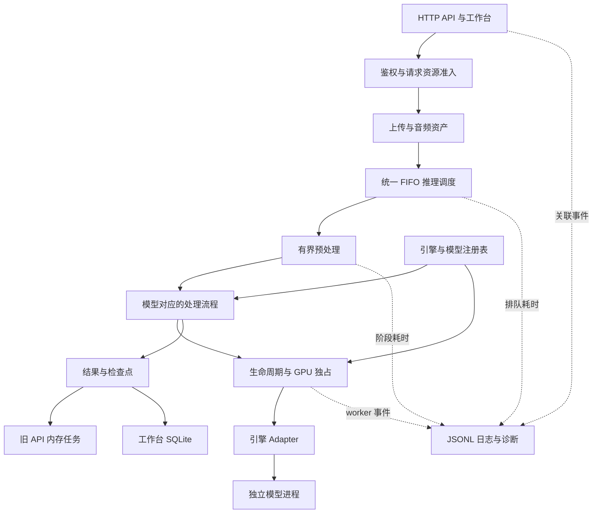

# ASR 服务性能与扩展改进计划

日期：2026-10-24。实施更新：2026-10-25，A–E 已落地；实际行为见[运行契约](asr-platform-runtime.md)，已测结果与未验收项见[平台验收](validation-2026-10-25-platform.md)及 [WSL 实机验收](validation-2026-10-25-wsl-platform.md)。下文保留原设计及目标值，不把目标视为实测结论。

建议以现有 FastAPI、SQLite、独立模型进程为基础，先补齐可追踪日志和媒体资源边界，再减少重复处理、统一推理调度，最后收拢模型接入接口。首轮继续采用单 GPU 串行推理，通过更少的复制、更短的阻塞和有界预处理提高吞吐，为新 ASR 保留稳定接口。

实现职责见 [Agent 任务包](asr-platform-agent-tasks.md)。2026-10-24 的规划轮仅新增文档；2026-10-25 执行轮修改运行代码并完成另行授权的 Windows 素材提取与 WSL 独立验收。

## 1. 基线与范围

- 源码基线：`2fb6a4dca0375ad2cbc3a20b2e3aa5b4b71cf852`；开始规划时工作区干净。
- 输入报告：[2026-10-24 安全审查](/Users/jinghao/security-audit-skill/asr_Server/run-1/REPORT.md)。报告保留 4 项 `needs_validation`，没有已确认漏洞。本计划中的 P0/P1 是实施顺序，不是漏洞严重性评级。
- 当前契约：[AGENTS.md](../AGENTS.md)、[API PRD](asr-server-prd.md)、[工作台契约](product-workbench.md)。`CLAUDE.md` 是 `AGENTS.md` 的符号链接。
- 源码静态统计：30 个 `tests/test_*.py` 文件、276 个测试函数；不等于 pytest 参数展开后的用例数，也没有测得当前测试耗时。
- 锁文件记录 FastAPI `0.138.1`、Starlette `1.3.1`、python-multipart `0.0.32`；这不是线上安装版本证明。

本轮保留 `18080` 单入口、`/v1` 与 `/api` 身份隔离、旧 API 内存任务、工作台七天保留、真实进度和现有质量流程。新模型尚未指定，本轮完成接入余量，不新增生产模型声明。Windows 原生安装包、vLLM、流式识别、多 GPU、分布式队列另立任务。

同步请求进入统一调度、有限预处理重叠、工作台列表摘要等行为变化，应由对应实现 Agent 同步更新上述契约；本文不自动覆盖现行行为。

## 2. 定位与优先级

以下行号对应源码基线，后续以函数名定位为准。

| 优先级 | 当前定位 | 观察与影响 | 设计处理 |
| --- | --- | --- | --- |
| P0 | `audio/splitter.py:392` `_interval_windows`；`:599` `_pack_vad_intervals` | VAD 长区间窗口生成缺少循环内进度、数量和取消检查；固定切分已有部分数量保护 | 统一有界窗口生成，按采样整数推进，累计数量限制在追加之前执行 |
| P0 | `main.py:191,271`；`audio/workspace.py:70` | File/Form 已解析后才进入上传配额；解析副本不在应用计数内 | 解析前正文限流、接收并发和磁盘预算；短期明确计算解析与复制两份峰值 |
| P0 | `audio/preprocess.py:214`；`transcription.py:353` | legacy 先完成解码，再检查工作区大小 | 解码输出按实际 PCM 字节有界写入；预算耗尽时停止并回收 decoder |
| P1 | `audio/preprocess.py:58,95,214` | probe/decode 自动识别格式，二级引用可接受性尚未验证 | 共同的协议和格式策略，限定普通上传媒体；验证实际 FFmpeg 构建的行为 |
| P0 | `jobs.py:390,497`；`workers/transport.py:73,176`；`workbench/service.py:368` | 已有零散日志和 IPC 请求号，缺少贯穿 HTTP、任务、chunk、worker 的关联信息 | JSONL 事件、阶段耗时、错误链、按任务检索诊断工具 |
| P1 | `workbench/service.py:398` → `quality/pipeline.py:133` | 工作台先生成 `audio.wav`，质量管线再次启动 FFmpeg 生成 `normalized.wav` | 引入内部可信音频资产，归一化一次，后续借用同一文件 |
| P1 | `workbench/service.py:135,146,258` | 容量检查递归扫描文件；提交时持有全局锁等待全文件摘要 | 容量账本、后台核对、每上传锁和短全局事务；摘要移出全局锁 |
| P1 | `workbench/store.py:81,120,138`；`workbench/router.py:79` | 同步 SQLite、完整 payload 读写、scrypt 直接出现在异步请求路径 | 有界线程执行完整数据库操作；状态摘要与正文分离；密码计算独立限并发 |
| P1 | `main.py:255`；`jobs.py:366`；`lifecycle.py:398` | 短同步请求直接执行管线；GPU 锁保证互斥，但任务 FIFO 未覆盖它 | 所有推理入口共享调度票据，HTTP 同步模式等待票据结果 |
| P1 | `frontend/src/App.tsx:32,49`；`ResultPane.tsx:21` | 每 3.5 秒轮询整个任务列表，结果页另轮询详情；列表接口读取完整 job payload 后再投影 | 摘要分页、修订号、活动任务轮询；终态正文只在变更时获取 |
| P1 | `main.py:76`；`registry.py:138`；`workbench/service.py:283` | adapter 选择、默认模型和工作台 profile 绑定散落在多个模块 | 引擎注册、模型配置和 pipeline 能力统一解析 |
| P2 | `adapters/qwen.py:493`；`lifecycle.py:507` | 当前 Qwen batch 实际逐项推理，quality 路径固定单块 | 如实声明串行 batch；真实 GPU batching 单独做有收益的实验 |

表中省略的 Python 路径均位于 `asr_server/`。性能项来自源码路径分析，尚不能量化各项占总耗时的比例。

## 3. 目标结构



职责沿用现有模块，新增模块只承担清晰边界：

| 边界 | 建议接口或对象 | 责任 |
| --- | --- | --- |
| 请求关联 | `ExecutionContext` | `trace_id`、提交请求 ID、job ID、attempt、取消信号；后台执行时显式绑定 |
| 资源准入 | `ResourceLease` | 接收、临时磁盘、解码输出的预留与一次性释放；区分逻辑配额和物理文件 |
| 音频资产 | `NormalizedAudioAsset` | 路径、采样规格、帧数、摘要、归一化版本、所有者；下游借用，不自行删除 |
| 调度 | `ScheduledOperation` | 单调序号、任务类型、资源类别、运行回调和结果 Future；不持有正文或音频 bytes |
| 引擎 | `EngineRegistration` | 固定 engine ID、adapter factory、worker 入口、支持的 pipeline 和运行时配置 ID |
| 模型 | 扩展 `ModelDefinition` | engine ID、HF repo/revision、能力、执行策略、输入规格、启用门槛 |

不引入通用 DAG 引擎、事件总线或数据库 ORM。先把重复职责移到这些窄接口，不同时重写整个服务。

## 4. 媒体资源边界

### 4.1 窗口生成

统一 `_chunk_windows`、`_interval_windows` 和 `_pack_vad_intervals` 的追加逻辑：

1. 在参数入口拒绝非有限数；将秒数转换为当前采样率下的整数帧。窗口长度至少一帧，`step_frames = chunk_frames - overlap_frames` 必须大于零。不能用 `value or default` 吞掉显式零。
2. 循环使用整数位置，保证 `next_start > current_start`、`end > start`，最后一块覆盖原区间尾部。量化后不合法的参数返回现有 `400 bad_request`。
3. 每次追加之前检查任务级累计数量，最多 4096 块；多个 VAD 区间共用额度，不能各自生成 4096 块后再合并。超过数量沿用 `422 duration_limit_exceeded`。
4. 取消信号传到扫描、区间合并和窗口生成；循环内检查。旧 job 的 cancel_requested、工作台取消/删除意图和任务取消都要驱动同一个线程可见信号，不能只处理 asyncio task 被取消的情况。真正模型调用仍按现有安全边界取消。
5. 固定分块可提前估算数量；VAD 逐区间消费剩余额度，避免先构建巨大中间列表。

验收只需一个边界矩阵和一个取消行为场景：正常 overlap、报告中的近等值 overlap、非有限数、跨区间超过累计上限。正常参数的覆盖范围和时间轴必须保持一致。报告原循环的动态验证应有迭代截停，不运行无界卡死请求。

### 4.2 请求解析与接收

在 `File/Form` 或 JSON 解析之前增加纯 ASGI 正文计数，顺序为：请求关联 → 适用的鉴权 → 接收准入 → 解析 → 业务处理。工作台保留 owner 在读取上传块之前校验。

- `Content-Length` 可用于提前拒绝；真正限制以每次 `receive` 的累计字节为准，缺少该头时仍受限。超限后不继续读取整个正文。
- `/v1` multipart 使用上传上限加明确的有限元数据额度；初始元数据额度建议 256 KiB。工作台 PATCH 保持 8 MiB；普通 JSON 建议 256 KiB，公共词库更新单独允许 1 MiB。这些是待实现验证的默认值，不改写当前配置。
- 限制单文件及字段数，保留既有 Form 参数和 OpenAPI；优先复用当前锁定框架可用的 parser 接口，只在一个 admission 模块中封装差异。
- 增加接收槽位，初始 4 个，满额快速返回 429。读超时、客户端断连和 `CancelledError` 都必须关闭 parser 文件、清理 workspace、释放已预留额度。
- multipart 解析副本与 `store_upload` 副本同时存在时，预算计算真实峰值。第一步允许两份有界副本；只有测出复制值得优化时，才改成受控 parser 直接拥有 workspace 文件。
- `max_part_size` 不能代替上传文件总量限制；当前 Starlette 文档明确区分非文件字段与上传文件。[Starlette 请求文档](https://starlette.dev/requests/#request-files)

本机已安装 Starlette 源码中未找到最新文档所述 `RequestBodyLimitMiddleware`；实现时以锁定版本核实为准，不为了使用一个便利接口顺便升级整套依赖。

临时存储使用服务专属目录。所有仍由框架创建的解析文件也必须落在可计量、可清理的受控临时根中；不能只把应用 workspace 移过去就宣称解析副本已经纳管。

### 4.3 有界解码与一次归一化

采用一个公共 `MediaPreprocessor` 管理 probe、decode、deadline、stderr 上限和取消。异步生产路径与保留的同步/bytes 包装都经由同一策略，避免补了一个入口、留下另一条无界路径。

输出采用 FFmpeg stdout 的原始单声道 PCM16，服务以固定小块读取、计数并写入 WAV，完成后补齐 WAV 头。每次写入前检查剩余额度；超过额度即停止 decoder、回收进程和部分文件。stderr 同时消费，只保留末尾有限内容，避免 PIPE 堵塞或完整堆积。

Qwen 当前规格为 16 kHz、单声道、PCM16：每秒 32,000 字节，六小时 PCM 为 691,200,000 字节，约 659 MiB。容器头、原上传及同时存活的副本额外计入预算。后续模型根据其 `AudioSpec` 计算，不把 16 kHz 写成所有 ASR 的强制规格。

- probe 时长只帮助提前估算；即使 probe 缺失、错误或低估，实际输出字节仍受硬限制。
- 为区分恰好达到上限和真实超限，允许读一个固定的小检查块，但超预算数据不写盘；读到额外采样后返回资源/时长错误，不能把截断结果作为完整音频送入 ASR。
- 不依赖 `-fs` 或 `-t` 单独实现完整性控制：输出变短不等于输入处理完成；FFmpeg 对 `-fs` 也不承诺输出精确等于指定字节。[FFmpeg 对文件大小限制的说明](https://ffmpeg.org/pipermail/ffmpeg-cvslog/2016-February/097967.html)
- 预算计入 parser、上传、规范音频、worker 临时片段及检查点。按文件系统分别核算可用空间；已经写入的字节不再作为尚未兑现的预留重复扣除。内部借用或硬链接同一资产也不重复计费。

工作台首次处理生成 `NormalizedAudioAsset`，质量管线直接读取；重试验证规格、帧数、文件存在及处理版本后复用。外部上传即使声称自己是 WAV，也不能自行设置“可信归一化”标记。摘要在写入规范音频时顺便计算；已有原文件摘要与规范音频摘要分别保存，不互相替代。

归一化实现或 WAV 容器字节变化可能改变现有 checkpoint 指纹。升级时明确区分旧资产与新资产：只有内容和身份验证一致才复用旧检查点，否则保留原记录并明确要求重跑，不能静默拼接。按所选模型规格直接从上传源生成目标音频；以后接入更高采样率模型时，不能把历史 16 kHz 资产升采样冒充原始高采样率输入。

规范音频由工作台或旧 API workspace 所有者删除；chunk 仅传递 `AudioPath` 视图。清理借用者的临时目录不得误删源资产。取消/删除等待借用释放，保留现有终态在清理之后发布的语义。

### 4.4 Decoder 访问范围

probe 和 decode 共用允许的输入协议及 demuxer 集合，优先支持当前实际使用的普通 WAV、MP3、FLAC、AAC/M4A、OGG、MP4/MOV、WebM/MKV。具体名称和组合以部署 FFmpeg 的能力表及小样本验证确定，不按文件扩展名授权。

- 输入协议限制排除网络访问；禁用上传播放列表、concat 脚本、HLS/DASH 等二级资源入口。
- 对保留的容器核实其外部引用开关。FFmpeg 文档中的 MOV `enable_drefs`、`use_absolute_path` 默认关闭；不能把应用没有显式写参数直接视为已可读取外部文件。[FFmpeg 格式文档](https://ffmpeg.org/ffmpeg-formats.html)
- `protocol_whitelist=file` 只控制协议，不能把文件访问限制在某个目录。若支持格式仍能请求外部文件，则在启用该格式之前增加 decoder 的进程级只读输入隔离，或暂不支持该格式；不把整个 ASR 服务权限当作 decoder 隔离。[FFmpeg 协议文档](https://ffmpeg.org/ffmpeg-protocols.html)

只用隔离 scratch 中的 dummy 文件/本地资源完成代表性兼容与拒绝验证。若没有找到可接受的二级引用，记录实际构建和拒绝结果；审查第 4 项保持原证据状态或按验证结果处置，不宣称“修复已确认 SSRF”。

## 5. 性能设计

### 5.1 统一推理排队

从 `JobManager` 提取小型 scheduler；旧内存 job、工作台 job、编辑对齐和短同步请求提交同一种 operation。状态与结果仍由各自 owner 管理，scheduler 不合并两套权限或持久化语义。

- 在输入已接收并提交时分配 FIFO 序号；后续准备完成时间不改变顺序。同步 HTTP 在等待 Future 时不持有模型锁或数据库事务。
- 仅在轮到该任务推理时取得 GPU 所有权。任务内质量复核及对齐属于同一调度单元，避免其他同步请求在其 chunk 间插入并反复切换模型。
- 管理员 load 使用相同 GPU 仲裁；unload 意图立即标记 `unloading_scheduled` 并拒绝新同模型请求，物理卸载仍等活跃调用结束。不要因持有长任务调度锁而阻塞卸载意图的登记。
- 同步请求排队取消或连接断开后，排队项可以移除；已经进入模型调用的请求等安全边界结束再清理。超过原十分钟阈值仍返回现有 202 job 响应，不因重构静默改变客户端协议。
- 队列容量统一计入所有等待/运行 operation。工作台可保留已落盘待入内存队列的任务；调度器看到它们后按统一顺序纳入，恢复时仍保持工作台 sequence 顺序。
- 首轮保持跨任务 FIFO，接受长任务的队头等待。按模型重排、短任务抢占和并发 GPU 推理会改变公平性与取消语义，留到有测量依据的后续任务。

锁的顺序固定为调度所有权 → 全局 GPU 锁 → runtime 请求锁/状态锁。既有函数自行持锁时不再从外层重复获取同一非重入锁；提取显式的“已经拥有 GPU”内部入口或复用现有唯一获取点。

### 5.2 预处理与推理有限重叠

基础模式仍可只处理当前任务。统一调度稳定后，允许当前任务推理时准备紧随其后的一个任务：解码并发初始 1、预取深度初始 1、GPU 并发固定 1。

预取先取得完整资源 lease；余量不足时等待，不能抢占当前任务运行所需磁盘。预取不启动模型、不改变推理顺序；取消、错误或关停释放已准备文件。当前任务以及预取项持有的音频资产和状态不得互相覆盖。推理和预取分别记录真实阶段，不把“准备好了”当作已转录。

同样覆盖 quality 管线，持续使用文件切片描述符，禁止把整段长音频或全部 chunk bytes 经 Pipe 复制。MOSS native long-form 本身需要的整段输入内存单独测量，不以 Qwen 的单块内存预算约束它。

### 5.3 工作台 I/O 与状态读取

1. 保留 SQLite WAL。通过有界 executor 执行完整 repository 操作，连接在执行线程内创建/关闭；不能在 event loop 建连接后随意交给其他线程，也不能把一个事务拆成多个无序 `to_thread` 调用。WAL 仍只有一个写者，增加线程数不会变成并行写入。[SQLite WAL 文档](https://www.sqlite.org/wal.html#concurrency)
2. `jobs` 保存可索引摘要、状态、修订号和容量信息；正文、版本和已完成 chunk 独立存放。列表、队列和维护扫描只查所需字段。增加 `status/sequence` 等与实际查询对应的索引。
3. 纯进度显示可在内存合并、最多每秒落盘一次；chunk 检查点、取消/删除意图、版本变更和终态立即持久化。先写检查点，再发布完成 chunk，重启不能因进度节流丢失结果。
4. 容量使用事务更新的保留/实际字节账本；日常接收、轮询不做整个数据目录的 `rglob`。启动恢复或低频维护在后台核对差额，扫描中使用保守预留并限制新准入。到期删除和失败清理释放一次。
5. 提交摘要计算移出全局 `service.lock`，使用每上传锁稳定文件；完成计算后在短事务内重新检查 offset、幂等键、删除意图及配置版本。保持既有硬链接提交的崩溃恢复能力。
6. 新增显式 `summary` 分页查询供前端使用，初始 50 条。旧列表调用保持兼容过渡；详情增加 revision/ETag。后台标签页降低轮询频率，终态停止固定周期重拉正文，编辑后主动失效刷新。不为这些更新引入 WebSocket。
7. 登录验证和管理员密码创建/重置共用限并发的密码 executor，初始 2 个执行槽；等待队列同样有上限，满时 429。失败登录地址表按 TTL 清理并设容量边界，保留同等失败返回及 scrypt 参数。
8. `/health` 读取缓存的 GPU 快照，采样在后台或 worker 初始化完成；轮询不触发同步 CUDA 查询或反复导入大包。保留既有响应结构，另加快照时间可以兼容演进。

管理员队列采用字段白名单：job ID、状态、模型、时间、队列位置、chunk 计数及错误码。普通管理状态不携带 chunk 正文、提示词或路径。它也能降低序列化和网络成本；这是新设计的接口收敛，不是报告已经证明的跨用户泄露。

## 6. 多 ASR 扩展接口

现有 `AsrAdapter`、`AudioPath`、`ModelCapabilities`、`ModelExecutionPolicy` 和 `ProcessRpcTransport` 已经提供可复用基础。需要移走的是散落的模型判断和重复协议代码。

### 6.1 注册与能力

- 在一个内部注册模块登记 `qwen`、`moss` 引擎与工厂。`main.create_app` 只做装配；默认模型从启用的注册项解析，取消“非 MOSS 一律走 Qwen”的兜底。
- `ModelDefinition` 增加 `engine_id`、模型源/固定 revision、输入规格、默认 pipeline、资源类型和运行时配置 ID。相同 revision 不再分别维护在 registry、adapter 和 smoke 脚本常量中。
- 扩展能力字段：支持的 quality profile、上下文是否支持、batch 是逐项还是原生、单批条数/音频时长预算。保持既有字段与错误码；`context_prompt` 不再无条件返回 true。
- 默认模型与 `purpose` 的选择按能力和明确优先级配置执行；未找到满足条件的模型返回 `capability_not_supported`，不悄悄降级。
- 注册不等于启用。真实模型只有满足现有 smoke 门槛才进入生产能力列表；新引擎测试 stub 仅存在于测试注入的 registry。

### 6.2 模型流程与 worker

基础转写、Qwen quality、MOSS long-form/Anchor Replay 保持各自 pipeline。将模型前缀判断换为“所选模型是否声明支持此 pipeline”；新 ASR 可以只支持基础转写，不必实现 Qwen 对齐或 MOSS 说话人处理。

普通转写结果复用 `TranscriptionResult`；把 `align_text` 等可选能力定义为单独协议，调用前通过 capability 校验。共同 IPC envelope、结果编解码、超时及异常转换收拢到 `workers/`；模型 prompt、加载和输出解析留在对应 adapter。内部协议包含 `protocol_version` 和 trace 元数据，启动 ping 验证版本。

当前引擎继续同一受管 Python 环境、独立 spawn 模型进程，保持重量依赖懒加载。`runtime_profile_id` 预留未来冲突依赖的独立解释器启动方式；本轮只实现现有 profile，不先造环境下载器、任意插件加载器或外部 HTTP worker。

工作台提交增加可选 `model`、`quality_profile`，不传时保持当前 Qwen quality 默认。前端只展示模型支持的组合，并根据 timestamps/diarization 能力显示编辑和字幕功能。幂等指纹与恢复身份必须包含模型、revision、engine/pipeline 版本、输入规格、参数、词库快照和对齐器/检测器版本；同音频换模型不能错误复用原任务。

### 6.3 接入成本的验收

通过测试注册一个无 GPU 的第三引擎，只支持基础转写且不支持对齐。新增内容限于该引擎实现、模型注册项和契约样例；HTTP 路由、scheduler、工作台任务持久化和结果导出不增加模型名分支。能力不足时必须在解码/推理前拒绝。

Qwen/MOSS 的模型窗口、显式语言 prefill、token 预算、空稿证据、speaker scope 和重试策略不在本轮顺便调整。现有 `transcribe_batch` 的逐项行为如实记录；原生 batch、量化、torch compile 或更换 attention backend 都须另测质量与显存收益。

## 7. 便于 Agent 调试的日志

### 7.1 日志与关联字段

使用标准 `logging` 加 JSONL formatter，先满足本地文件/journald 检索，不引入外部日志服务。API 入口生成可信 `request_id` 并返回 `X-Request-ID`；一次任务贯穿一个 `trace_id`，每次重试独立 attempt。客户端关联标识可以单独记录经长度/字符约束的值，不覆盖服务生成的 ID。

公共字段：`schema_version`、UTC `ts`、`level`、`event`、`service_instance_id`、`pid`、`trace_id`、`request_id`、`job_id`、`attempt`、`model_id`、`engine_id`、`pipeline_id`。阶段事件按需增加 `chunk_index`、`start_s/end_s`、`duration_ms`、`queue_wait_ms`、`worker_pid`、`worker_generation`、`rpc_request_id`、`error_code`。

HTTP request ID、任务 ID、IPC 自增 ID 分字段存储。使用 ContextVar 方便局部记录；进入后台 FIFO 和子进程时仍显式传递 context，不能假定请求的上下文会自动跟随整个 job。

```json
{"schema_version":1,"ts":"2026-10-24T08:00:00Z","level":"INFO","event":"chunk.completed","service_instance_id":"svc_example","trace_id":"tr_example","job_id":"wb_example","attempt":1,"model_id":"qwen3-asr-1.7b","engine_id":"qwen","pipeline_id":"quality_v1","chunk_index":3,"start_s":180,"end_s":240,"duration_ms":4210,"worker_pid":1234,"worker_generation":2,"rpc_request_id":8}
```

这是字段示例，不是实测耗时。

### 7.2 必需事件

| 事件组 | 必须能回答的问题 | 内容 |
| --- | --- | --- |
| `request.completed/rejected` | 哪次调用、在哪个入口被拒绝 | 路由模板、状态码、读取字节、耗时、错误码；成功轮询降为 DEBUG |
| `job.queued/started/completed/failed/cancelled` | 排多久、何时开始、为什么结束 | 序号、排队时间、attempt、阶段耗时汇总 |
| `media.probed/normalized/reused` | 卡在解码还是发生重复处理 | 输入/输出字节、音频秒数、spec、预算、decoder 退出类别 |
| `split.completed` | 为什么这么多块 | 请求/实际策略、块数、窗口范围摘要、参数 |
| `model.loading/loaded/unloading/unloaded` | 为什么反复加载、显存何时释放 | 切换原因、耗时、模型 revision、运行时版本 |
| `worker.started/rpc_failed/reaped` | 哪个进程、哪次调用失败 | worker generation、RPC ID、operation、deadline、退出码 |
| `chunk.started/completed/retried` | 停在哪一块、是否一直重试 | 区间、尝试次数、耗时、token 数及已有显存指标 |
| `quality.review/checkpoint_hit/checkpoint_miss` | 为什么复核、能否续跑 | reason code、复核预算、检查点命中原因，不写正文 |
| `cleanup.completed/failed`、`resource.rejected` | 配额是否归还、遗留在哪一层 | lease ID、资产类型、释放字节、剩余预留 |

未知异常保留异常类型和栈帧，worker 将有限诊断元数据送回父进程统一记录；诊断放在 IPC 内部字段，不能直接并入会返回客户端的 `AsrError.details`。前端仍拿稳定错误码和 request/trace ID。栈帧不包含 locals，原始异常 message 与 FFmpeg stderr 先过滤秘密、路径和自由文本，再限长记录。不能只留下通用 `transcription_failed`，也不能直接序列化整个 request/exception 对象。

默认不记录音频、转录正文、热词文本、密码、Cookie、Token、环境变量全集或完整本机路径。记录长度、任务内引用和必要 fingerprint 足够定位；调试时由有权限的工具读取原任务材料，正文不复制进日志。

### 7.3 开销与保存

- 网关使用有界 `QueueHandler/QueueListener` 将文件 I/O 移出 event loop；建议起始队列 4096 项，单条 JSONL 8 KiB 上限。Python 官方 cookbook 提供这一模式。[Python 3.12 logging cookbook](https://docs.python.org/3.12/howto/logging-cookbook.html#dealing-with-handlers-that-block)
- `ASR_LOG_LEVEL=INFO`、`ASR_LOG_FORMAT=json`、可选 `ASR_LOG_DIR`；调试可按 job 临时提高详细级别，不需要全站 DEBUG。
- 父进程是应用轮转日志的唯一写者，核心 worker 开始/结束/异常从 IPC 边界记录。第一版不让多个 spawn 进程共享同一个 rotating file handler，也不在推理 Pipe 混入异步日志帧。
- 队列饱和时先丢 DEBUG/重复成功事件，统计 dropped count；关键状态和失败有预留空间。持续拥塞仍需有界降级，明确暴露丢失计数，不能阻塞 GPU 或声称日志永不丢失。
- 有界磁盘输出建议总量 100 MiB、最长 7 天，先到者触发清理；文件权限限服务用户。stdout 交给 journald 时遵循 journald 自身保留设置，不把应用文件轮转配置说成控制了 journald。
- INFO 每 chunk 只写开始/结束和必要异常。不能按采样帧、生成 token 或每次成功轮询写日志；不为取指标同步 CUDA，不在日志路径扫描整个目录。

### 7.4 诊断入口

新增对服务数据只读的 `scripts/asr_diagnostics.py`，支持两种操作：

1. `trace --job <id> --log-dir <dir>`：输出时间线、最后成功阶段、耗时、错误链和相关 worker；JSON 供 Agent 读取，文本供人工查看。
2. `bundle --job <id> --log-dir <dir> --data-dir <dir> --output <path>`：显式生成有大小上限的诊断包，包含关联日志、白名单配置、构建/运行时版本、任务参数摘要和检查点清单。默认不含正文、音频、SQLite 全库或凭据。

这两个命令是待实现接口。诊断工具不得启动模型、重试任务、下载依赖或隐式连接远程节点。旧 `/v1` 任务重启后可能已经丢失，日志可以定位失败，不能承诺恢复不存在的请求材料。

## 8. 测试精简方案

目标是减少重复验证和对实现细节的绑定，让测试能阻止有用户影响的回归。按用例价值处理，不以覆盖率 100% 或固定删减比例为目标。

### 8.1 可明确执行的删改

| 当前用例/位置 | 处理 | 保留的行为证据 |
| --- | --- | --- |
| `test_api.py:47` 文档说明测试 | 删除英文句子、换行、中文标题的逐字断言；合成一条文档路由 smoke | 路由可访问、响应类型、OpenAPI 可解析 |
| `test_api.py:901` `test_unsupported_capability_returns_422` | 删除，合入 `:912` 拒绝发生在 decode 之前的更强用例 | 稳定错误信封且未消耗解码资源 |
| `test_api.py:169,713,890` vLLM 拒绝相关 | 合并为按入口参数化的能力拒绝矩阵；同入口同条件只保留一次 | load、transcription 等不同路由仍各验证一次 |
| `test_api.py:876` 与 `test_jobs.py:652` 上传过大 | 以入口参数化的一组集成检查替代重复 setup，并强化解析前截止 | 两个入口均 413，文件/预留能清理 |
| `test_qwen_adapter.py:121`、`test_moss_adapter.py:64` 固定 repo 常量 | 注册集中后删除孤立常量断言 | 真实加载边界收到注册表指定的 repo/revision |
| `test_dependency_pins.py:29` SDK 字符串 | 移到发布依赖检查，检查约束一致性及锁文件；不把某个版本字符串作为运行单测 | 升级依赖时的清晰发布检查 |
| `test_config.py:35–70` 同类错误 | 合并参数化表，保留有意义的非法类别 | 字段解析、边界和错误定位；参数化不计作减少执行次数 |
| `test_qwen_adapter.py:518–631` 卸载清理 | 合并公共 fixture；删除精确列举所有辅助函数调用顺序的断言 | 引用释放、必要先后关系、局部清理失败仍完成卸载 |
| `test_api.py:80` 全量复制能力常量 | 改为接口与同源模型定义一致；在策略测试保留关键产品阈值 | 不出现声明/实现漂移，不锁死新增模型 |
| 各文件重复 `make_wav`、client、轮询 helper | 收拢到 `conftest.py` / 小型 helpers，统一短样本 | 缩小样板和 fixture 成本，不改变测试覆盖 |

涉及旧常量检查的删除必须在单一注册表完成后执行；不能先删除唯一覆盖，再把替代证据留作未来工作。移入发布检查也不算功能验证已经删除。

### 8.2 应继续保留

- 账号/Bearer 隔离、owner 条件、管理员重置密码后会话失效。
- 全局 GPU 互斥、活跃请求时延迟卸载、取消后仍持有调用所有权、worker 超时回收。
- 终态在文件清理之后、重复清理只释放一次、删除意图不会被晚到结果复活、取消与关停的优先级。
- Qwen 显式语言 prefill、空稿的双视图语音证据、真实时间戳、MOSS 缺尾与 speaker scope。它们影响结果真实性，不因分支多而删除。
- checkpoint 身份不匹配、复核预算不重置、恢复后不拼接不同版本结果。
- 备份/恢复完整性、发布包排除 secrets/运行数据、部署保留已有设置。

这些复杂测试可以改成短 fixture 和事件同步，减少 sleep；删除前必须能说明原行为由哪条更强测试覆盖。

### 8.3 新增测试预算与执行方式

每个根因新增一个行为场景；只有不同真实边界才增加参数。窗口边界、解析前截止、解码硬预算各一组；decoder 兼容与二级引用只用小样本。日志用一条“HTTP→后台任务→RPC→失败”关联检查加一条敏感字段/队列饱和检查，不逐条测试每个 INFO 文案。

调度用同步、异步、工作台、对齐组成的一个混合序列检查顺序和最大 GPU 活跃数。多 ASR 使用统一 Adapter 契约矩阵和一个第三引擎 stub；模型 prompt/解析只保留模型特有回归。

默认 CI 继续运行所有必要本地行为测试与 mypy；新增 `integration`、`gpu`、`performance`、`release` 标记，真实 GPU/长素材性能单独执行。当前默认本来就不会跑未配置地址的 HTTP smoke，不把新增 marker 宣称成既得提速。

实现中只跑受影响模块；每个任务包收尾一次相称的检查，最终集成再完整回归一次。基线和收尾各记录 `pytest --durations=20`、collect 后数量及总耗时，列出真正删除、合并和迁移的用例。没有新变化或失败就不反复全量跑。

## 9. 性能验收与质量门槛

以下数值是建议的起始验收预算，需在同机基线后确认，不能写成已经达到的性能。

| 指标 | 测量方式与目标 |
| --- | --- |
| 请求响应 | 暖机 localhost，10 个每 3.5 秒轮询的客户端、2 个上传、1 个推理任务；health 和摘要列表 p95 目标低于 100 ms，event loop lag p95 低于 50 ms |
| 归一化 | 工作台首次任务最多归一化一次；同规格正常重试为零次；文本/音频时轴不改变 |
| 解码资源 | WAV 文件从不写过授予上限；超预算后的内存额外占用只允许固定缓冲；取消/deadline 后 decoder 无遗留 |
| 控制面内存 | Qwen 文件路径管线使用 10 分钟、1 小时、6 小时 fixture；网关 RSS 增量起始预算 256 MiB，不能随完整 PCM 线性增长；模型 worker/decoder 单独统计 |
| GPU 与模型切换 | 最大并发 GPU 调用 1；相邻同模型任务复用已加载模型；每次切换有可解释的 load/unload 日志 |
| 预取收益 | 对同一任务序列比较关闭/开启预取的批次总完成时间和 GPU 等待空档；收益不足测量波动时默认关闭 |
| 日志开销 | 相同工作负载比较 INFO 与关闭应用事件的耗时，目标额外开销不超过 3%；持续拥塞内存不增长，dropped 计数可见 |
| 查询增长 | 100/1000/10000 条合成任务记录比较摘要查询，单次响应规模由 page size 决定，不读取全文，不扫描整个目录 |

统一记录：上传、probe、decode、split、queue_wait、model_load、inference、alignment、review、persist、cleanup；部分阶段重叠时不能把它们简单相加当总耗时。`RTF_processing = 处理墙钟时间 / 原音时长`，另列含排队的 `RTF_end_to_end`。吞吐以整个批次音频秒数除以批次墙钟时间，单独报告冷启动和已加载模型。

短/中样本至少三次，报告中位数和波动范围；六小时资源边界只做必要的预处理/恢复检查，真实六小时识别质量仍须有独立音频和人工参考文本。保持模型、revision、参数、音频、硬件和缓存状态一致后才能比较性能。

mock 能验收资源账本、调度和 API；真实吞吐、显存释放、CUDA 兼容及识别质量需要另行授权的 WSL 验收。性能优化不能通过减小显式生成预算、丢弃静音区间、跳过必要对齐或关闭质量复核取得。

## 10. 推进与回滚

按五个工作包推进：A 日志与基线 → B 媒体资源与归一化 → C 调度与工作台性能 → D 多 ASR 接入接口 → E 测试精简与集成验收。A/B 完成即可独立形成一轮可靠性改进；后续不必等待所有抽象完成才受益。

每包控制在可独立审查、可回退的变化内。共享 `main.py`、`config.py`、`transcription.py`、`lifecycle.py` 的改动按任务顺序交接，避免多个 Agent 同时大改。

数据库调整采用有版本迁移：新增列/表、回填、校验，再切换读取；初期保留旧 payload 以便核对，禁止删除再重建用户数据库。schema 版本、迁移耗时、待恢复任务和容量账本均写入验收记录。发布回滚恢复匹配的代码、前端和数据库备份，不让旧程序直接读取新 schema。

预取保持开关可退回深度 0；新注册器保留旧环境变量兼容映射；日志级别可调整但不能用关闭日志掩盖错误。资源边界修复不提供默认开启的绕过开关。

报告中的其他建议按影响处理：CI Action 固定审核过的 commit，放入 E 的发布配置维护；MCP 校验和打开之间的竞态在引入低信任本地写入主体时再做同描述符重构，当前保留已有路径/类型/大小校验；备份继续按包含账号与音频的可信整库数据管理，不重写已存在的恢复系统。管理员摘要、登录并发、JSON 上限和上传取消清理已分别纳入 C、B。

最终交付应有：根因到改动的映射、实际性能对比、测试删改去向、第三引擎接入示例、诊断命令示例、数据迁移/回滚说明，以及仍未验证的明确事项。提交、推送、部署和 Windows 操作继续遵循用户当前授权。
