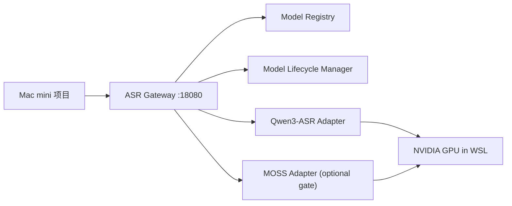

# WSL ASR Server PRD

2026-10-25 平台实现扩展：解析前资源准入、统一同步/异步推理 FIFO、一次归一化资产、schema 3 摘要分页与正文分离、关联日志及显式引擎注册，以[平台运行契约](asr-platform-runtime.md)为准。真实 GPU 与质量验收状态见对应验收记录。

更新时间：2026-10-22

2026-10 产品化扩展：新增同端口局域网工作台、个人账号、SQLite 持久任务、7 天音频及结果保留、断点上传与分块检查点、公共词库和 `quality_v1`。完整新增合约见 [工作台与质量流程](product-workbench.md)，该合约覆盖后文历史“暂不做 Web 管理后台 / 不引入数据库”的范围说明。旧 `/v1/**` 默认 `quality_profile=legacy` 并继续原内存任务及 Bearer 语义；网页 `/api/**` 使用个人 Cookie 会话。新流程和 6 小时质量必须通过真实评测后才能宣布已验收。

2026-09 升级说明：本版把细粒度强制对齐、单期长播客全局说话人、逐素材 Context/关键词和 Mac 侧批量落盘纳入正式范围。本文后文若仍出现“初版不要求时间戳”的历史措辞，以本说明及对应能力发现字段为准。

## 1. 背景

面向 Windows + NVIDIA + WSL 用户提供常驻 ASR 服务，让局域网内的 Agent、应用和脚本通过 HTTP 调用同一台电脑的 GPU 转录能力。客户端可在支持 stdio MCP 的 Host 中运行本地 bridge。已实机验证的环境为 WSL2 Arch Linux + RTX 5070 Ti 16GB，以及 Mac mini 客户端；其他硬件和客户端平台需要独立验收。

基础默认模型包含 Qwen3-ASR 两个尺寸：

- QwenLM/Qwen3-ASR：https://github.com/QwenLM/Qwen3-ASR

当前实现还支持一个可选 gate 模型：`moss-transcribe-diarize-0.9b`。只有在 WSL 侧 MOSS smoke 验收通过并设置 `ASR_ENABLE_MOSS=1` 后，它才进入 `/v1/models`。默认模型仍是 `qwen3-asr-1.7b`。

MiMo-V2.5-ASR 不进入初版交付范围，保留为后续扩展候选。

历史验收基线（不是所有新用户的固定配置）：

- Windows 主机：RTX 5070 Ti 16GB VRAM
- WSL：Arch Linux，已启用 mirrored networking
- WSL 资源：32GB RAM，12 CPUs，16GB swap
- 历史验收入口：`http://192.168.31.137:18080`；新部署使用用户的 Windows LAN IP

## 2. 目标

构建一个常驻 WSL 后台的统一 ASR 网关，让局域网 Agent、应用和脚本通过可探测、可管理的 API 共用已验收的 GPU 转录能力。

必须支持：

- 查询服务健康状态。
- 查询 ASR 服务端支持哪些模型、每个模型的能力与加载状态。
- 请求加载指定模型。
- 请求卸载指定模型或全部模型。
- 卸载模型时保证当前正在执行的请求完成后再卸载，并拒绝新的同模型请求。
- 上传音频并获取转写结果。
- 创建异步转录任务，并通过轮询获取阶段状态和 chunk 级真实进度。
- 跑通 `qwen3-asr-0.6b` 和 `qwen3-asr-1.7b` 的端到端转录流程。
- 对每个 Qwen3-ASR 模型跑通所有在 `/v1/models` 中声明支持的推理后端；第一版只声明 `transformers` 后端，`vllm` 后端延后到后续版本。
- 如果启用 MOSS，跑通 `moss-transcribe-diarize-0.9b` 的 `transformers` 后端，并只把段级 speaker/timestamp 作为 `verbose_json` 的 `segments` 返回。
- Qwen 使用官方 Qwen3 ForcedAligner 按需产生真实细粒度时间信息；不得用均分文字或 chunk/VAD 窗口冒充词/字对齐。
- Context 与关键词必须进入模型提示，并在响应中报告 `requested/applied/method/truncated/ignored_reason`。
- Mac 侧按清单批量提交、恢复并原子落盘，供新 Agent 只读取输出目录完成交接。
- `/v1/models` 只声明已经实现且在当前部署中启用的能力；流式和 vLLM 仍不在本轮范围。

暂不做：

- 公网访问。
- 多用户计费。
- 分布式多机调度。
- Web 管理后台。
- Windows Docker 部署。
- MiMo-V2.5-ASR 适配器与验收。

## 3. 用户与场景

服务部署者是拥有 Windows、NVIDIA GPU 和 WSL2 的用户；服务调用方是局域网内的 Agent 产品、应用和脚本。Mac mini 是已经实机验证的客户端，不是唯一目标用户。

典型场景：

1. Mac 项目启动时调用 `GET /v1/models`，发现服务端可用模型与能力。
2. Mac 项目上传音频到 `POST /v1/audio/transcriptions`，指定服务端在 `/v1/models` 中声明的模型，例如 `model=qwen3-asr-1.7b` 或 `model=qwen3-asr-0.6b`。
3. 长音频或批处理时，Mac 项目创建异步任务，再轮询任务状态。
4. 长时间不用某个模型时，Mac 项目或运维脚本调用卸载接口释放显存。
5. 如果服务端正在处理请求，卸载动作进入排队状态，当前请求结束后再释放模型。

## 4. 总体架构

采用单一 HTTP 网关加模型适配器结构。



建议进程：

- `asr-gateway`：对 Mac 暴露 HTTP API，监听 `0.0.0.0:18080`。
- `qwen-adapter`：可先内嵌在 gateway 进程内，后续如需 vLLM serving 再拆成独立 worker。

端口规划：

- `18080`：唯一对 Mac mini 暴露的正式 ASR API 入口。服务进程运行在 WSL Arch Linux 内，监听 `0.0.0.0:18080`；Windows 侧只需要为这个端口添加专用网络入站防火墙规则。
- `8001`：可选的 WSL 内部 Qwen3-ASR worker 端口。只有当后续把 Qwen 适配器拆成独立 worker 进程时才使用；默认第一版不需要开放。若启用，必须只绑定 WSL 内部 loopback 或 Unix socket，不为 Windows 防火墙添加入站规则，不对 Mac mini 暴露。

历史测试端口 `8765` 不属于正式设计，不应写入部署、启动、自启或防火墙配置。正式验收只使用 `18080`。

## 5. 模型能力矩阵

| 模型 | 模型 ID | 首选用途 | 当前验收能力 | 限制 |
| --- | --- | --- | --- | --- |
| Qwen3-ASR 0.6B | `qwen3-asr-0.6b` | 轻量转写、对齐 smoke | 离线转写、Context prompt、`transformers`、按需官方 forced alignment | 中文实际粒度按 aligner 返回，通常为 CJK 字单元；英文为词；未启用 `ASR_ENABLE_QWEN_ALIGNMENT=1` 时不得声明 timestamps |
| Qwen3-ASR 1.7B | `qwen3-asr-1.7b` | 默认转写与口播分析 | 离线转写、Context prompt、`transformers`、按需官方 forced alignment | 对齐器额外占用显存并懒加载；不支持 streaming 或 vLLM |
| MOSS-Transcribe-Diarize | `moss-transcribe-diarize-0.9b` | 长播客匿名说话人 | 离线转写、Context prompt、`language=auto`、`transformers`、段级时间、Anchor Replay 全局标签（上限 4 人） | 超过 1801 秒自动分块，`speaker_resolution=auto|required` 启用 Anchor Replay；无法可靠归属时为 unresolved/mixed；不声明 word/char forced alignment、streaming 或 vLLM |

## 6. API 设计

### 6.1 健康检查

`GET /health`

返回：

```json
{
  "status": "ok",
  "version": "0.1.0",
  "host": "archlinux-wsl",
  "gpu": {
    "available": true,
    "name": "NVIDIA GeForce RTX 5070 Ti",
    "vram_total_mb": 16303
  }
}
```

### 6.2 查询模型

`GET /v1/models`

返回：

```json
{
  "models": [
    {
      "id": "qwen3-asr-1.7b",
      "provider": "QwenLM",
      "status": "unloaded",
      "default": true,
      "capabilities": {
        "transcription": true,
        "streaming": false,
        "timestamps": [],
        "forced_alignment": false,
        "languages": ["auto", "zh", "en", "yue", "ar", "de", "fr", "es", "pt", "id", "it", "ko", "ru", "th", "vi", "ja", "tr", "hi", "ms", "nl", "sv", "da", "fi", "pl", "cs", "fil", "fa", "el", "hu", "mk", "ro"],
        "chinese_dialects": ["Anhui", "Dongbei", "Fujian", "Gansu", "Guizhou", "Hebei", "Henan", "Hubei", "Hunan", "Jiangxi", "Ningxia", "Shandong", "Shaanxi", "Shanxi", "Sichuan", "Tianjin", "Yunnan", "Zhejiang", "Cantonese-Hong-Kong-accent", "Cantonese-Guangdong-accent", "Wu", "Minnan"],
        "backends": ["transformers"]
      }
    },
    {
      "id": "qwen3-asr-0.6b",
      "provider": "QwenLM",
      "status": "unloaded",
      "default": false,
      "capabilities": {
        "transcription": true,
        "streaming": false,
        "timestamps": [],
        "forced_alignment": false,
        "languages": ["auto", "zh", "en", "yue", "ar", "de", "fr", "es", "pt", "id", "it", "ko", "ru", "th", "vi", "ja", "tr", "hi", "ms", "nl", "sv", "da", "fi", "pl", "cs", "fil", "fa", "el", "hu", "mk", "ro"],
        "chinese_dialects": ["Anhui", "Dongbei", "Fujian", "Gansu", "Guizhou", "Hebei", "Henan", "Hubei", "Hunan", "Jiangxi", "Ningxia", "Shandong", "Shaanxi", "Shanxi", "Sichuan", "Tianjin", "Yunnan", "Zhejiang", "Cantonese-Hong-Kong-accent", "Cantonese-Guangdong-accent", "Wu", "Minnan"],
        "backends": ["transformers"]
      }
    }
  ]
}
```

### 6.3 查询单个模型状态

`GET /v1/models/{model_id}/status`

状态枚举：

- `unloaded`
- `loading`
- `loaded`
- `unloading_scheduled`
- `unloading`
- `error`

返回：

```json
{
  "id": "qwen3-asr-1.7b",
  "status": "loaded",
  "active_requests": 1,
  "rejecting_new_requests": false,
  "backend": "transformers",
  "loaded_at": "2026-06-26T21:30:00+08:00",
  "last_used_at": "2026-06-26T21:34:12+08:00",
  "vram_allocated_mb": 7420
}
```

### 6.4 加载模型

`POST /v1/models/{model_id}/load`

请求：

```json
{
  "backend": "auto",
  "device": "cuda",
  "dtype": "auto"
}
```

返回：

```json
{
  "id": "qwen3-asr-1.7b",
  "status": "loading",
  "message": "model loading started"
}
```

### 6.5 卸载单个模型

`DELETE /v1/models/{model_id}`

请求：

```json
{
  "mode": "after_current_requests",
  "reject_new_requests": true,
  "cuda_empty_cache": true
}
```

语义：

- 如果模型没有正在运行的请求，立即卸载。
- 如果模型有正在运行的请求，立刻把状态改为 `unloading_scheduled`。
- 状态为 `unloading_scheduled` 后，新的同模型转写请求返回 `409 model_unloading_scheduled`。
- 已经开始的请求正常完成。
- 最后一个活跃请求结束后执行卸载并清理 CUDA cache。

返回：

```json
{
  "id": "qwen3-asr-1.7b",
  "status": "unloading_scheduled",
  "active_requests": 2,
  "rejecting_new_requests": true
}
```

### 6.6 卸载全部模型

`DELETE /v1/models`

请求：

```json
{
  "mode": "after_current_requests",
  "reject_new_requests": true,
  "cuda_empty_cache": true
}
```

返回：

```json
{
  "status": "accepted",
  "models": [
    {
      "id": "qwen3-asr-1.7b",
      "status": "unloading_scheduled",
      "active_requests": 1
    },
    {
      "id": "qwen3-asr-0.6b",
      "status": "unloaded",
      "active_requests": 0
    }
  ]
}
```

### 6.7 同步转写

`POST /v1/audio/transcriptions`

Content-Type: `multipart/form-data`

字段：

- `file`：音频文件，必填。
- `model`：模型 ID，默认 `qwen3-asr-1.7b`。
- `language`：`auto`、`zh`、`en` 等，默认 `auto`。
- `response_format`：`json`、`text`、`verbose_json`，默认 `json`。
- `purpose`：`transcription`、`oral_analysis`、`podcast`。`oral_analysis` 默认 `verbose_json + timestamps=auto + preserve_segments=true`；`podcast` 默认 `verbose_json + speaker_resolution=auto` 且不做逐字对齐。显式字段可覆盖配置，但仍按能力发现校验。
- `timestamps`：`none`、`auto`、`word`、`char`，普通转写默认 `none`。响应必须包含实际 `granularity`、`source` 和 `status`；请求粒度与实际语言粒度不符时返回 warning，不伪造。
- `backend`：`auto`、`transformers`、`vllm`，默认 `auto`。
- `temperature`：可选。
- `max_new_tokens`：可选；使用模型专属限制。Qwen 默认 512、上限 4096；MOSS 未指定时按单次模型输入时长动态计算 `max(2048, ceil(seconds * 12))`，上限 65536。多 chunk Anchor Replay 在调用方未显式指定时额外使用 `24000` 的自动预算下限；显式请求值不受该下限覆盖。
- `context`：可选；本次素材的领域背景。控制字符会规范化，正文上限 3000 字符，总 prompt 上限 4000；超限截断必须可见。
- `hotwords`：可选；逗号分隔或 JSON 字符串数组，去空、大小写去重，最多 100 个、单项 120 字符。它们是参考词汇而非强制输出清单，不能改变服务权限。
- `idempotency_key`：异步提交可选；同键、同内容、同参数返回原 job，不同指纹返回 `409 idempotency_conflict`。它只解决提交重试，不等同结果缓存。
- `speaker_resolution`：`off`、`auto`、`required`，默认 `off`。只对声明支持的 MOSS 模型生效；`auto` 允许部分结果，`required` 在存在冲突、未解析段或候选说话人时返回 `422 speaker_resolution_incomplete`。

返回：

```json
{
  "id": "tr_01JZ0000000000000000000000",
  "model": "qwen3-asr-1.7b",
  "backend": "transformers",
  "language": "zh",
  "text": "这是转写结果。",
  "duration": 12.35,
  "timestamps": [],
  "segments": [],
  "usage": {
    "audio_seconds": 12.35
  },
  "warnings": []
}
```

### 6.8 强制对齐

正式路径是转录接口的 `timestamps=auto|word|char`：先取得原始 ASR 文本，再使用固定 snapshot 的 `Qwen/Qwen3-ForcedAligner-0.6B-hf` 对原音频对齐。对齐结果在分块合并时加回原媒体 offset；静音不会被压缩。`timing.reading_segments` 只是按间隔组织阅读，`semantic_sentence=false`；`pause_candidates` 也只表示声学候选，不代表语义意图。

独立 `POST /v1/audio/alignments` 仍为预留接口，当前不接受调用；不得因为内嵌转录对齐已实现就提供不存在的独立 API 示例。

`POST /v1/audio/alignments`

预留接口，后续仅 Qwen3-ASR 模型支持。只有当对应模型和后端已通过能力验收时，`forced_alignment` 才能在 `/v1/models` 中标记为 `true`。

Content-Type: `multipart/form-data`

字段：

- `file`：音频文件，必填。
- `text`：需要对齐的文本，必填。
- `model`：默认 `qwen3-asr-1.7b`。
- `language`：默认 `auto`。
- `granularity`：`word` 或 `char`。

返回：

```json
{
  "id": "al_01JZ0000000000000000000000",
  "model": "qwen3-asr-1.7b",
  "language": "zh",
  "granularity": "char",
  "items": [
    {
      "text": "这",
      "start": 0.0,
      "end": 0.18
    }
  ]
}
```

如果请求不支持强制对齐的模型或后端：

```json
{
  "error": {
    "code": "capability_not_supported",
    "message": "requested model/backend does not support forced alignment in this server"
  }
}
```

### 6.9 异步任务与进度查询

- `POST /v1/audio/transcription-jobs`
- `GET /v1/jobs/{job_id}`
- `DELETE /v1/jobs/{job_id}`

适合长音频、批处理、前端需要进度展示、或 Mac 项目不希望 HTTP 长连接阻塞的场景。

第一版采用内存 job manager 和单 worker FIFO 队列：

- 服务端可以接收多个 job，但同一时间只运行一个转录 job。
- 后提交的 job 保持 `queued`，通过 `queue_position` 暴露排队位置。
- 不引入 Redis、Celery、数据库或多 worker 推理。
- 进程重启后内存 job 可以丢失；客户端应将 `job_not_found` 视为需要重新提交。
- job 结果默认保留 1 小时，之后可过期清理。

进度边界：

- 服务端必须暴露真实阶段：`queued`、`preprocessing`、`splitting`、`loading_model`、`transcribing`、`merging`、`completed`、`failed`。
- 切分完成后，必须暴露真实 chunk 级进度：`total_chunks`、`completed_chunks`、`current_chunk`、`percent`。
- 每个 chunk 完成后，`progress.chunk_text` 返回该 chunk 的稳定文本，`progress.text` 返回所有已完成 chunk 的累计临时文本，`progress.chunks` 返回截至当前的有序 `{index,text}` 列表，保证轮询跨过多个 chunk 时客户端仍能完整恢复；进入最终合并后以 `result.text` 为准。
- Qwen adapter 当前拿不到单个 chunk 内部推理百分比，不能伪造模型内部 token/帧级进度。
- native long-form 只有一次真实模型调用，没有完成的中间 chunk，因此不得伪造 `text`、`chunk_text` 或 chunk 内进度。

`POST /v1/audio/transcription-jobs`

Content-Type: `multipart/form-data`

字段与同步转写接口保持一致，第一版只要求支持单个 `file`。服务端收到请求后应快速返回 `202 Accepted`，不在该 HTTP 请求内执行真实转录。

返回：

```json
{
  "id": "job_01JZ0000000000000000000000",
  "status": "queued",
  "model": "qwen3-asr-1.7b",
  "backend": "transformers",
  "queue_position": 1,
  "created_at": "2026-06-29T12:00:00Z",
  "status_url": "/v1/jobs/job_01JZ0000000000000000000000"
}
```

`GET /v1/jobs/{job_id}`

队列中返回：

```json
{
  "id": "job_01JZ0000000000000000000000",
  "status": "queued",
  "model": "qwen3-asr-1.7b",
  "backend": "transformers",
  "queue_position": 2,
  "progress": {
    "phase": "queued",
    "percent": 0.0,
    "message": "waiting for previous transcription jobs"
  },
  "created_at": "2026-06-29T12:00:00Z",
  "started_at": null,
  "completed_at": null,
  "elapsed_seconds": 0.0
}
```

转录中返回：

```json
{
  "id": "job_01JZ0000000000000000000000",
  "status": "transcribing",
  "model": "qwen3-asr-1.7b",
  "backend": "transformers",
  "queue_position": 0,
  "progress": {
    "phase": "transcribing",
    "percent": 37.5,
    "total_chunks": 32,
    "completed_chunks": 12,
    "current_chunk": 13,
    "current_chunk_start": 1412.4,
    "current_chunk_end": 1530.1,
    "text": "前十二个已完成分片的累计临时文本。",
    "chunk_text": "第十二个分片的稳定文本。",
    "chunks": [{"index": 1, "text": "第一块文字。"}, {"index": 12, "text": "第十二块文字。"}],
    "message": "transcribing chunk 13 of 32"
  },
  "split": {
    "strategy": "silero",
    "requested_strategy": "auto",
    "vad_backend": "silero",
    "chunk_count": 32,
    "soft_chunk_seconds": 120,
    "hard_chunk_seconds": 300,
    "overlap_seconds": 2
  },
  "created_at": "2026-06-29T12:00:00Z",
  "started_at": "2026-06-29T12:00:03Z",
  "completed_at": null,
  "elapsed_seconds": 74.3
}
```

完成后返回：

```json
{
  "id": "job_01JZ0000000000000000000000",
  "status": "completed",
  "progress": {
    "phase": "completed",
    "percent": 100.0,
    "total_chunks": 32,
    "completed_chunks": 32
  },
  "result": {
    "id": "tr_01JZ0000000000000000000000",
    "model": "qwen3-asr-1.7b",
    "backend": "transformers",
    "language": "zh",
    "text": "完整合并后的转写文本。",
    "duration": 3630.05,
    "split": {},
    "chunks": [],
    "usage": {
      "audio_seconds": 3630.05
    },
    "timings": {},
    "warnings": []
  },
  "error": null,
  "created_at": "2026-06-29T12:00:00Z",
  "started_at": "2026-06-29T12:00:03Z",
  "completed_at": "2026-06-29T12:04:12Z",
  "elapsed_seconds": 249.0
}
```

失败后返回：

```json
{
  "id": "job_01JZ0000000000000000000000",
  "status": "failed",
  "progress": {
    "phase": "failed",
    "percent": 37.5,
    "total_chunks": 32,
    "completed_chunks": 12
  },
  "result": null,
  "error": {
    "code": "gpu_unavailable",
    "message": "CUDA out of memory during Qwen ASR",
    "details": {
      "phase": "transcribing",
      "chunk_index": 12
    }
  }
}
```

`DELETE /v1/jobs/{job_id}`

取消语义：

- `queued` job 可以直接取消为 `cancelled`。
- `preprocessing`、`splitting`、`merging` 阶段尽量在阶段边界取消。
- `transcribing` 阶段不要强杀模型推理，不要卸载模型；设置 `cancel_requested`，等当前 chunk 完成后停止后续 chunk。
- 已结束 job 的 DELETE 返回当前状态，不应报 500。

### 6.10 流式转写

第一版可以先不实现，但接口预留如下：

- `WebSocket /v1/audio/transcriptions/stream`

Qwen3-ASR 官方支持流式推理，但当前边界需要在 API 中明确：

- Qwen3-ASR streaming 当前依赖 vLLM backend；transformers backend 不作为流式实现路径。
- 流式请求不支持 batch inference。
- 流式请求不返回 timestamps；需要 timestamps 时应使用非流式转写或强制对齐接口。
- 流式转写面向“实时输入”，例如麦克风、通话、边录边转；不替代长音频文件上传后的服务端切分。
- 如果流式转写未在初版实现或未通过验收，`/v1/models` 中对应模型的 `streaming` 必须为 `false`。

建议流式 API：

```text
WebSocket /v1/audio/transcriptions/stream?model=qwen3-asr-1.7b&language=auto
```

客户端发送 16kHz PCM 音频帧，服务端返回增量文本事件：

```json
{
  "type": "partial",
  "text": "正在识别中的临时文本",
  "is_final": false
}
```

```json
{
  "type": "final",
  "text": "稳定后的最终片段文本",
  "is_final": true
}
```

如果请求端上传的是已经存在的完整音频文件，即使使用 Qwen3-ASR，默认仍走 `POST /v1/audio/transcriptions`，由 ASR server 执行切分、批处理、合并和可选时间戳。

### 6.11 服务端音频切分与合并

请求端可以一次上传一个非无限长音频，或通过客户端清单逐项上传多个音频。切分、批处理、模型窗口适配、结果合并由 ASR server 负责；请求端不需要理解不同模型的推荐输入长度。

设计原则：

- 请求端只表达业务意图，例如模型、语言、是否需要时间戳、是否允许长音频异步处理。
- 服务端根据模型能力、音频时长、显存状态、是否需要时间戳，决定切分窗口。
- 对外返回原始音频级别的结果，同时保留 chunk 级别元数据，方便调试。
- 对长音频优先使用异步任务接口；同步接口只适合短音频和中等长度音频。

输入字段扩展：

- `split_strategy`：`auto`、`none`、`fixed`、`silero`、`energy`、`vad`，默认 `auto`；`vad` 是兼容别名。生产 Path 管线当前优先使用 bounded streaming energy VAD；`silero` 在新的流式实现通过六小时 RSS 验收前会明确 fallback 到 energy 并返回 warning。
- `max_chunk_seconds`：可选；用户给上限时不得超过服务端模型上限。
- `overlap_seconds`：可选；默认由服务端决定。
- `preserve_segments`：是否返回 chunk 级别结果，默认 `false`。
- `speaker_resolution`：同转录接口；启用时必须使用 `response_format=verbose_json`。

服务端默认执行策略：

1. 使用 FFmpeg 解码并规范化音频元数据，生成服务端临时 WAV/PCM，再统计总时长、采样率、声道数和文件大小。
2. Qwen 的 `auto` 保持通用 chunked ASR：短音频不切分，长音频使用 bounded streaming energy VAD，失败后固定窗口。
3. MOSS 的 `auto` 是 model-aware：不超过 1801 秒时整段单次推理，speaker scope 为 `global`；更长音频自动降级为 1800 秒 fixed chunk。默认 `speaker_resolution=off` 时 speaker scope 为 `chunk`，并返回明确 fallback warning。
4. MOSS 显式 `split_strategy=none` 可用于挑战尚未验证的更长原生推理，但缺尾、token 达上限、上下文超限都必须返回 422，不能返回表面成功的残缺正文。
5. 分块合并时按原始时间线排序并处理 overlap。`speaker_resolution=off` 时 MOSS speaker 使用 `chunk-NNNN:S01` 命名空间。显式 `auto|required` 时，每个后续正文块前回放最多 60 秒的已知说话人干净片段，在同一次 MOSS 调用内把本地标签映射成 job-local `speaker-NNNN`；正文窗口上限收缩到 1200 秒。该上限不仅给锚点前缀留出输入窗口，也给高语速、多人密集播客的输出 token 密度留出余量；1740 秒正文已在真实四人播客上出现只覆盖至约 1324 秒的受控 `incomplete_transcript`。未显式传 `max_new_tokens` 时，Anchor Replay 单次调用的自动生成预算不得低于 24000；此前 1200 秒正文加 60 秒锚点按 12 tokens/秒只得到 15120，并在真实四人播客第 3 块触发 `generation_truncated`。单个说话人标签必须至少有一段连续 2 秒的稳定语音才可建立 job-local 全局身份；片头音效或极短插话只保留为待确认片段，不能污染后续锚点。
6. Anchor Replay 不把名字或真实身份凭空赋给声音；`source_speaker` 保留原始 chunk-local 标签。锚点冲突、新说话人尚未在后续块确认、或锚点预算不足时 scope 为 `mixed`，不得伪造数值置信度。
7. 返回 `execution`、`split`、`generation`、`diarization`、`chunks`、`warnings` 和 timings，供客户端判断真实执行模式、speaker scope、token、冲突与尾部覆盖。

默认模型窗口：

| 模型 | 默认 soft chunk | 默认 hard chunk | overlap | 说明 |
| --- | --- | --- | --- | --- |
| `qwen3-asr-1.7b` | 120 秒 | 300 秒 | 2 秒 | WSL RTX 5070 Ti 实测后默认按 2 分钟软切分，配合默认 `max_new_tokens=512` 降低显存峰值。请求时间戳或强制对齐时，单段不得超过 300 秒。 |
| `qwen3-asr-0.6b` | 120 秒 | 300 秒 | 2 秒 | 与 1.7B 保持一致；后续可根据吞吐测试放宽。 |
| `moss-transcribe-diarize-0.9b` | 原生至 1801 秒；超出后 1800 秒 fixed；Anchor Replay 正文 1200 秒 | 1801 秒（自动分块） | splitter 默认值 | 原生单次调用返回全局 speaker；分块默认返回 chunk-local。显式启用 Anchor Replay 后可返回 global/mixed；当前真实验收人数为 4。显式 `none` 的 6 小时输入限制不等于已验收能力。 |

同步与异步阈值：

- 单个请求总音频时长小于等于 10 分钟时，允许走同步 `POST /v1/audio/transcriptions`。
- 单个请求总音频时长超过 10 分钟时，同步接口应返回 `202 accepted` 并创建异步 job，响应包含 `id` 和 `status_url`；如果暂未实现自动创建 job，必须返回明确错误并提示客户端使用 `POST /v1/audio/transcription-jobs`。
- 单文件默认最大 6 小时。
- 超过服务端限制返回 `413 audio_too_large` 或 `422 duration_limit_exceeded`。

返回示例：

```json
{
  "id": "tr_01JZ0000000000000000000000",
  "model": "qwen3-asr-1.7b",
  "text": "完整合并后的转写文本。",
  "duration": 742.3,
  "split": {
    "strategy": "silero",
    "requested_strategy": "auto",
    "vad_backend": "silero",
    "chunk_count": 5,
    "soft_chunk_seconds": 120,
    "hard_chunk_seconds": 300,
    "overlap_seconds": 2
  },
  "chunks": [
    {
      "index": 0,
      "start": 0.0,
      "end": 178.4,
      "text": "第一段文本。",
      "warnings": []
    }
  ],
  "warnings": []
}
```

### 6.12 客户端 MCP Bridge

MCP 支持采用客户端 stdio bridge（已实机验证 Mac），不在 WSL FastAPI 中新增远程 MCP endpoint：


设计约束：

- MCP 是现有 HTTP 接口的协议适配器，不替代 REST API，也不得重复实现模型生命周期、队列、切分、能力校验或推理逻辑。
- `/v1/models` 仍是模型和能力真相来源；MCP Host 调用转录前应先执行能力发现。
- bridge 运行在持有音频文件的客户端上，使用 multipart 把文件上传到 `18080`；不把本地音频转成 base64 放入 MCP JSON 参数。
- bridge 使用 `httpx` 的 `trust_env=false` 访问局域网地址，避免 Mac 本机代理拦截请求。
- WSL 不新增 MCP 端口，不开放 `8001`，也不恢复历史端口 `8765`。
- 第一版不挂载远程 `/mcp`。后续若启用 Streamable HTTP MCP，必须先实现认证、`Origin` 校验和受控上传票据，并继续复用同一应用层实现。
- FastAPI `/docs` 顶部必须提示 Mac 侧 MCP 用法，并链接到 `GET /docs/mcp`；该 endpoint 直接返回仓库内同一份 Markdown 教程，避免线上说明与仓库文档漂移。

stdio MCP tools：

| Tool | HTTP 映射 | 语义 |
| --- | --- | --- |
| `asr_list_models` | `GET /v1/models` | 查询模型、能力、后端和状态 |
| `asr_get_model_status` | `GET /v1/models/{model_id}/status` | 查询单模型生命周期 |
| `asr_transcribe_file` | `POST /v1/audio/transcriptions` | 上传本地音频；超过同步阈值时允许返回 job |
| `asr_create_job` | `POST /v1/audio/transcription-jobs` | 显式创建异步 job |
| `asr_get_job` | `GET /v1/jobs/{job_id}` | 查询真实阶段、chunk 进度和结果 |
| `asr_cancel_job` | `DELETE /v1/jobs/{job_id}` | 使用既有安全取消语义 |
| `asr_load_model` | `POST /v1/models/{model_id}/load` | 加载已声明模型 |
| `asr_unload_model` | `DELETE /v1/models/{model_id}` | 使用既有等待活跃请求完成语义 |

文件安全：

- `ASR_MCP_ALLOWED_ROOTS` 必填，macOS 使用系统路径分隔符 `:` 配置一个或多个允许目录。
- bridge 必须先解析真实路径，再确认目标是允许目录内的普通文件；指向目录外的符号链接必须拒绝。
- bridge 在发起网络请求前执行路径和文件大小检查；越权路径不得产生 HTTP 请求。
- `ASR_MCP_MAX_FILE_MB` 默认与服务端上传限制一致为 512 MB，但服务端限制仍是最终约束。
- MCP tool error 应保留服务端错误信封中的稳定 `code` 和 `message`，不得把 `capability_not_supported` 等错误静默降级为表面成功。

## 7. 错误码

统一错误格式：

```json
{
  "error": {
    "code": "model_not_found",
    "message": "unknown model: xxx",
    "details": {}
  }
}
```

错误码：

| HTTP | code | 场景 |
| --- | --- | --- |
| 401 | `unauthorized` | 启用 Token 时请求缺失或携带错误 Bearer 凭据 |
| 400 | `bad_request` | 参数缺失、非法枚举值 |
| 408 | `audio_probe_timeout` / `audio_preprocess_timeout` | ffprobe 或 FFmpeg 超过服务端 operation deadline |
| 404 | `model_not_found` | 模型 ID 不存在 |
| 404 | `job_not_found` | job ID 不存在、已过期或服务重启后丢失 |
| 409 | `model_loading` | 模型正在加载，暂不能处理请求 |
| 409 | `model_unloading_scheduled` | 模型已安排卸载，拒绝新请求 |
| 409 | `job_cancel_requested` | job 已请求取消，不能重复启动或修改 |
| 413 | `audio_too_large` | 音频超出服务限制 |
| 415 | `unsupported_audio_format` | 音频格式不支持 |
| 422 | `capability_not_supported` | 请求了模型不支持的能力 |
| 429 | `job_queue_full` | 异步转录队列达到服务端上限 |
| 500 | `inference_failed` | 模型推理失败 |
| 503 | `gpu_unavailable` | GPU 不可用或显存不足 |
| 503 | `worker_unavailable` | 模型 Worker 超时、崩溃、Pipe 关闭或协议错误，旧进程已回收 |
| 503 | `storage_unavailable` | 临时盘剩余空间、workspace bytes 或文件数量不足 |

## 8. 运行与部署

部署脚本默认在当前 WSL checkout 原地安装；推荐位置为 `~/services/asr-server`，保持 Linux 原生文件系统。历史 `/home/fragt/services/asr-server` 不是产品固定路径。

使用 Python 3.12、uv、FastAPI 和 Uvicorn。首次部署运行 `bash deploy/wsl-deploy.sh`，完成 CUDA 和 Qwen 独立 smoke 后安装 systemd user service。实际常驻使用部署目录 `.venv/bin/uvicorn`，避免启动时重新同步依赖。

- Windows 11 22H2+ 配置 mirrored networking；只允许专用网络 TCP `18080`。
- 不开放 worker `8001` 或历史测试端口。
- 客户端使用 Windows 主机实际 LAN IP，并绕过本机代理；本地默认地址是 `http://127.0.0.1:18080`。
- 真实模式需要显式 `ASR_ADAPTER=qwen`；默认 mock 仅用于无 GPU 开发。
- 完整部署、WSL 保活和 Windows 启动配置以 `docs/wsl-deployment.md` 为准。

## 9. 后台常驻要求

服务应满足：

- Windows 开机后可自动启动 WSL 服务。
- 服务崩溃后可自动重启。
- 模型不必开机即加载，可 lazy load。
- 首次请求某个模型时可自动加载，但返回时间可能较长。
- 转录完成后 3 分钟内没有新的同模型转录请求时，自动卸载模型并清理 CUDA cache；新请求到来时取消上一轮空闲卸载计时，直到该请求结束后重新计时。

建议配置：

```yaml
server:
  host: 0.0.0.0
  port: 18080
  public_base_url: http://YOUR_WINDOWS_LAN_IP:18080

models:
  default: qwen3-asr-1.7b
  auto_load_on_request: true
  idle_unload_seconds: 180
  max_loaded_models: 1

limits:
  max_upload_mb: 512
  max_audio_seconds_sync: 600
  request_timeout_seconds: 3600
  job_result_ttl_seconds: 3600
  max_queued_jobs: 20
```

## 10. 安全要求

由于服务只给局域网使用，第一版可使用轻量认证：

- 设置 `ASR_API_TOKEN` 后 `/v1/**` 必须提供正确的 `Authorization: Bearer <token>`；缺失或错误返回 `401 unauthorized` 错误信封，并在读取上传正文前拒绝。未配置时保持现有无认证行为。
- `/health`、`/docs`、`/openapi.json` 和 MCP 配置文档公开；启用 Token 时 Swagger 提供 Authorize。CLI / batch 使用 `ASR_TOKEN`，MCP 使用 `ASR_MCP_TOKEN`。
- 部署的 systemd unit 从可选 `.env` 读取环境；直接 Python / Uvicorn 与 MCP Host 不会自动读取 `.env`。
- 默认只监听局域网地址或 `0.0.0.0` 配合 Windows 专用网络防火墙。
- 不允许公网端口映射。
- 上传音频写入临时目录，推理结束后清理。
- 同步转录、异步 job、音频解码、切分和模型适配器产生的临时文件必须在请求完成、失败或取消后清理；job 结果 TTL 只允许保留内存中的结果和状态，不保留上传音频或中间音频文件。
- 日志不默认保存完整音频内容。
- Mac 侧 MCP bridge 只能读取 `ASR_MCP_ALLOWED_ROOTS` 内解析后的普通文件，不允许把整个 home 目录或文件系统根目录作为生产配置。
- MCP 配置中的 `ASR_MCP_TOKEN` 只能通过 MCP Host 环境变量注入，不写入 Git、命令行日志或工具返回值。

## 11. 验收标准

连通性：

- Mac mini 执行 `curl --noproxy '*' http://YOUR_WINDOWS_LAN_IP:18080/health` 返回 `status=ok`。
- Mac mini 执行 `curl --noproxy '*' http://YOUR_WINDOWS_LAN_IP:18080/v1/models` 能看到 `qwen3-asr-0.6b` 与 `qwen3-asr-1.7b`。
- 当 WSL 服务设置 `ASR_ENABLE_MOSS=1` 且 MOSS smoke 验收通过时，`/v1/models` 能看到 `moss-transcribe-diarize-0.9b`。
- `/v1/models` 不展示未进入初版交付范围的 MiMo 模型，也不声明未验收通过的高级能力。

转写：

- Mac mini 通过局域网向 `POST /v1/audio/transcriptions` 上传一段 10 秒中文音频，`qwen3-asr-0.6b` + `transformers` 返回非空 `text`。
- Mac mini 通过局域网向 `POST /v1/audio/transcriptions` 上传一段 10 秒中文音频，`qwen3-asr-1.7b` + `transformers` 返回非空 `text`。
- 如果启用 MOSS，Mac mini 通过局域网上传短音频，`moss-transcribe-diarize-0.9b` + `transformers` + `response_format=verbose_json` 返回非空 `text` 和段级 `segments`。
- MOSS 30 分钟级 `auto` 返回 `execution.mode=native_long_form`、`speaker_scope=global` 且时间轴覆盖结尾；超过 1801 秒时返回明确的 automatic fallback、chunk-local speaker scope 和完整尾部覆盖。
- MOSS 显式 `speaker_resolution=auto` 的四说话人、两块重复声音验收返回 4 个稳定 job-local speaker、`status=complete`、0 conflict、0 unresolved；默认 `off` 行为不变。
- 默认模型 `qwen3-asr-1.7b` 在不显式传 `backend` 时可以用 `backend=auto` 完成转录。
- 前端 Mac 客户端只依赖 `GET /v1/models` 的模型与后端发现结果，不硬编码服务端未声明的能力。

异步 job：

- Mac mini 能创建 `POST /v1/audio/transcription-jobs`，拿到 `202`、`id` 和 `status_url`。
- `GET /v1/jobs/{job_id}` 能看到 `queued`、运行中状态和最终 `completed`。
- chunked 长音频中，`progress.total_chunks`、`completed_chunks`、`current_chunk` 会随真实 chunk 完成而变化；native long-form 单次模型调用只报告真实阶段，不伪造 chunk 内百分比。
- chunked 长音频每完成一个 chunk 后，`progress.chunk_text` 返回该分片文本，`progress.text` 返回累计临时文本，`progress.chunks` 返回可恢复的有序已完成分片；最终结果仍以 `result.text` 为准。
- 多个 job 同时提交时，服务端只运行一个，其余 job 显示 `queued` 和正确 `queue_position`。
- job 完成后 `result.text` 非空，结构与同步转写结果兼容。
- job 失败时返回统一 error 对象，包含错误 code、message、details 和失败阶段。

模型管理：

- 模型处于 `loaded` 时，`DELETE /v1/models/{model_id}` 能将其卸载。
- 模型有活跃请求时，卸载请求进入 `unloading_scheduled`。
- `unloading_scheduled` 状态下，新请求返回 409。
- 活跃请求完成后，模型进入 `unloaded`。

能力探测：

- 请求未声明的高级能力，例如 timestamps、forced alignment 或 streaming，返回 `capability_not_supported`，或在能力未声明时由客户端避免发起该请求。
- 任意出现在 `/v1/models` capabilities 中的能力都必须有对应的 Mac 到 WSL 端到端验收记录。

MCP：

- Mac MCP Host 通过 stdio 启动 bridge，`tools/list` 能发现 8 个 ASR tools。
- `asr_list_models` 的模型和能力结果与 HTTP `GET /v1/models` 一致。
- 允许目录内短音频可通过 `asr_transcribe_file` 得到非空 `text`；长音频可创建 job 并获取真实 chunk 进度。
- 允许目录外文件和解析后逃逸目录的符号链接返回 ToolError，且不会向 WSL 发起 HTTP 请求。
- MCP 调用不新增局域网监听端口，真实推理仍只发生在 WSL Arch Linux GPU 环境。

## 12. 后续路线

当前 WSL 服务端已经实现异步 job、FIFO 串行队列、可轮询状态、model-aware MOSS long-form/自动降级、opt-in MOSS Anchor Replay、chunk 级真实进度、Qwen 官方 ForcedAligner、Context 应用报告和 Mac 批量恢复/落盘。后续阶段不做 vLLM、WebSocket streaming、MiMo、数据库队列、多 worker 并发推理或独立声纹 embedding/聚类，除非 PRD 再次扩展范围并以真实数据证明收益。

优先级 P0：

- FastAPI 网关。
- 模型注册表。
- Qwen3-ASR 0.6B 与 1.7B 适配器最小可用转写。
- Qwen3-ASR 两个尺寸在 `transformers` 后端上完成端到端转录验收。
- MOSS gate、MOSS `transformers` 后端和 `verbose_json` segments 端到端验收。
- 模型加载/卸载状态机。
- Mac 局域网访问验收。

优先级 P1：

- 转录耗时记录，包括总耗时、加载耗时、推理耗时和后处理耗时。
- 长音频切分与合并，先支持固定切分和 chunk 元数据。
- 异步转录 job 和 chunk 级进度查询。
- 异步任务。
- 上传文件大小、时长、格式限制。
- systemd user service 或 Windows 开机启动。
- Qwen 时间戳与强制对齐真实 GPU 验收；仅在通过后设置 `ASR_ENABLE_QWEN_ALIGNMENT=1`。

优先级 P2：

- Qwen vLLM 独立 worker。
- WebSocket 流式转写。
- MiMo-V2.5-ASR 适配器调研与转写验收。
- 简单 Web 管理页。
- 多模型队列与优先级。

## 13. 参考资料

- Qwen3-ASR GitHub：https://github.com/QwenLM/Qwen3-ASR
- MOSS-Transcribe-Diarize GitHub：https://github.com/OpenMOSS/MOSS-Transcribe-Diarize
- MOSS-Transcribe-Diarize Hugging Face：https://huggingface.co/OpenMOSS-Team/MOSS-Transcribe-Diarize
- MiMo-V2.5-ASR GitHub：https://github.com/XiaomiMiMo/MiMo-V2.5-ASR
- WSL mirrored networking 已在本机验证，历史验收入口为 `192.168.31.137:18080`，产品运行地址由用户配置
