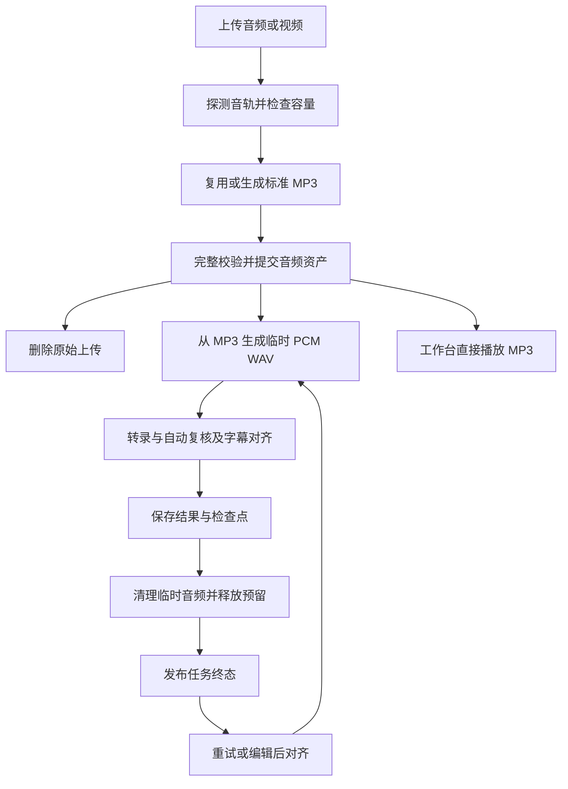

# 工作台高质量音频与存储执行方案

日期：2026-10-26。状态：实现与工程验收完成；实机、发布证据及未验收质量边界见[验收记录](validation-2026-10-26-workbench-audio.md)。

工作台统一保留 192 kbps MP3，供回听、重试和编辑后对齐使用。识别所需 PCM WAV 与分片只在操作期间存在，操作结束后清理。旧任务直接删除，不提供旧音频或旧检查点兼容路径；保留账户和公共词库。

## 产品规则

| 项目 | 本轮规则 |
| --- | --- |
| 标准音频 | MP3，192 kbps CBR；每小时约 82.4 MiB，不含少量封装开销 |
| 采样率 | 原音为 44.1 或 48 kHz 时保持；其他采样率统一转为 48 kHz。升采样不代表恢复原素材细节 |
| 声道 | 单声道、双声道保持；多声道按固定规则混为双声道，并记录处理方式 |
| 音轨 | 本轮沿用首条音轨，记录实际音轨索引；多音轨素材在界面提示所选音轨 |
| 声音处理 | 不额外降噪、响度归一化、增益增强或裁剪静音 |
| 符合标准的 MP3 | 完整校验编码、帧、时长、采样率和声道后直接复用；不能仅凭扩展名或平均码率判断 CBR |
| 原始上传 | 标准 MP3 完整校验、原子落盘且元数据持久化后删除；转换失败时保留以供重试 |
| 保留期 | 成功、失败、取消任务仍按终态后七天保留；手动删除覆盖音频、结果、检查点与版本 |
| 界面名称 | “高质量回听 · MP3 192 kbps”；不称为无损原音，不承诺修复低质源音 |

本轮范围为工作台 `/api/**`。旧 `/v1/**`、官方客户端 Skill、模型能力、质量参数和单 GPU FIFO 保持现有契约。容量展示和刷新随本轮修正；批量清理、长期文字归档、音质档位和高级多音轨选择留待后续。

## 完整处理流程

首次转录、重试和编辑对齐都以同一份标准 MP3 为输入。PCM 资产在一次操作内部共享，避免重复解码；操作之间按需重建。标准 MP3 不随重试或编辑重复编码。

第一版编辑对齐使用完整、受控的 PCM 解码，再按现有整数采样窗口取段，优先保证时间一致性。暂不加入 MP3 快速随机截取优化，避免编码帧边界、编码延迟和时间偏移影响对齐；长素材准备期间显示“正在准备音频”。

## 后端实施

### 标准音频资产

在 `asr_server/audio/` 增加标准音频处理模块，与现有模型输入规范化模块分离。持久文件使用 `audio.mp3`，写入时使用 partial 文件；沿用有界处理、取消信号、超时、输入协议限制和磁盘预算。

保存音频版本、SHA256、实际字节、实际解码时长、编码规格、来源音轨、时间轴信息及编码和解码工具身份。保留上传 SHA256 作为素材溯源与幂等身份，不要求保留原文件。

标准化完成必须验证：输出可完整解码、没有截断或解码错误、实际有效时长与所选源音轨一致、输出规格正确，且没有超过六小时限制。时长比较考虑 MP3 编码延迟和尾部填充，不能只比较容器 duration；文件末尾异常不能作为完整成功交付。

元数据明确区分 preparing、ready、failed。落盘与数据库无法组成单一事务，需要用原子重命名和启动恢复规则衔接：标准音频未提交为 ready 时不得删除唯一上传源；重启后检查 ready 文件的存在性和身份，回收无引用 partial。源码发布前检查目标 FFmpeg 是否提供 MP3 编码器。

### 转录与对齐生命周期

修改 `asr_server/workbench/service.py` 的 `prepare_audio`、任务执行、重试和 `align_edit`，将持久 `audio.wav` 改为操作拥有的临时 PCM 资产。

- 转录、自动复核和初始字幕对齐全部退出后，清理操作目录和 lease，再发布终态；异常路径遵守相同顺序。
- 编辑对齐独立申请空间、创建 PCM，保留既有任务归属、版本冲突、FIFO 和删除意图检查，结束后清理。
- 使用中的音频不能被任务删除或过期清理提前移除；删除请求等待活跃消费者安全退出，防止晚到结果恢复已删任务。
- MP3 已就绪的失败或取消任务保留 MP3 和有效检查点；标准化尚未成功的任务保留 source，清理 partial，并允许重新准备。
- 服务重启清理失去 owner 的临时文件，释放无效预留；保留可继续处理的任务与检查点。

### 检查点与数据库

工作台 schema 升级为 4，增加持久音频信息及分类容量账目，修改版本守卫。删除旧任务后只保留新流程，不新增 legacy WAV 回放或旧任务恢复分支。

检查点继续保留模型、参数、词库、流程与 PCM 身份校验，并纳入标准 MP3 摘要及解码规范。新建 PCM 后重新验证摘要；版本变动导致身份不同则明确拒绝混用检查点，提供从头重试，不静默拼接。

旧源文件路径和 inode 不作为跨操作稳定身份；临时文件重建后更新资产引用。账户、密码哈希、公共词库及其版本保留。新数据结构不要求导入旧任务正文或 legacy payload。

### 播放接口

`GET /api/jobs/{id}/audio` 返回 `audio.mp3`，使用 `audio/mpeg`，保留归属校验、Range、私有缓存策略和错误信封。MP3 未 ready 时返回明确的准备中状态。

任务详情增加音频状态、格式、采样率、声道、实际大小及有效时长，前端据此显示；播放不依赖识别 WAV 的存在。

## 容量与界面

容量账目区分已保存文件、文字与版本、临时文件已落盘占用及尚未兑现预留。可分配配额使用完整占用与未兑现预留计算，各分类互斥，不能把已落盘的预留再加一次。管理端物理磁盘可用量与工作台配额单独表达。

转换峰值必须计入 source、MP3 和操作临时 PCM 同时存在的情况。MP3 的 192 kbps 仅用于估算；以实际字节和实际解码帧数执行边界检查。临时 WAV 删除后及时结算，删除失败不能提前报告空间已释放。

界面本轮改动：

1. 上传前说明“素材将保存为高质量 MP3，原始音视频在转换完成后删除；任务结束后保留七天”。
2. 增加“准备回听音频”和“准备识别音频”阶段，采用真实阶段或可测进度，不虚构编码百分比。
3. 播放器显示格式与准备状态；文件 ready 后自动恢复可播放状态，不要求手动刷新整页。
4. 容量卡显示“已保存”“处理占用及预留”“剩余可分配”；单位与实际计算一致，采用 MiB/GiB。
5. 上传、提交、完成、取消、对齐结束及删除后刷新容量，切回可见页面时补刷新；轻量统计独立于模型能力请求。
6. 提供轻量 `GET /api/storage`，返回个人分类用量及配额；管理接口返回全局分类。任务摘要增加该任务的持久音频大小，查询走账本，不在轮询时遍历目录。

涉及前端主要文件：`App.tsx`、`UploadPane.tsx`、`ResultPane.tsx`、`AdminPane.tsx`、`api.ts`。保持现有长文虚拟列表、时间跳转和移动端布局。

## 实施顺序与交付

| 顺序 | 工作 | 完成判据 |
| --- | --- | --- |
| 1 | 标准 MP3 资产与 schema 4、容量基础 | 上传可形成已校验 MP3；失败不会删除唯一有效源文件；编码和解码均受资源边界约束 |
| 2 | 接通转录、重试、编辑对齐与统一清理 | 一条完整流程可在删除 PCM 后播放、改字对齐和重试；异常与重启后没有无主临时音频 |
| 3 | 播放 API、容量接口与前端状态 | Range 回听和文字跳转可用；音频无需页面刷新恢复；操作后容量同步更新 |
| 4 | 旧任务清理工具、文档和本地验收 | 清理仅作用工作台任务及其上传、文件和账目；账户与词库不变；本地检查通过 |
| 5 | WSL 实机验证与发布 | 真实编码、GPU 转录、对齐、清理和浏览器验收通过，发布记录可追溯 |

采用一条端到端主线推进，先完成“上传 → MP3 → 转录 → PCM 清理 → 回听 → 改字对齐”，再补齐异常与发布流程。

## 验收标准

| 范围 | 必须验证的行为 |
| --- | --- |
| 编码 | WAV、AAC/视频、合规 MP3 复用、不合规 MP3 转码；单/双/多声道；异常输入和缺失编码器有明确错误 |
| 完整性 | 时长和尾部完整；低估时长、超六小时、磁盘不足、取消和进程中断均受控，不产生假 ready |
| 生命周期 | 成功、失败、取消、删除、关停及重启恢复；终态无识别 WAV/分片残留，MP3 或转换失败保留源符合规则 |
| 重试与对齐 | PCM 已删后仍能重试和改字对齐；同一运行版本重建身份一致；不一致时拒绝复用；保留版本冲突保护 |
| 播放 | 鉴权、跨用户隔离、Range 206；目标桌面与手机浏览器能播放和跳转；PCM 删除不影响回听 |
| 时间轴 | 标记测试音频与视频偏移样本；检查开头、中段和末尾，排除编码延迟与累计漂移；工程标记偏差目标不超过 100 ms，不作为模型对齐准确率承诺 |
| 音质与识别 | 同源原音、旧 16 kHz WAV、新 MP3 对照试听；覆盖口播、音乐背景、低音量和中英混说；用固定参考文本比较识别及对齐结果，退化逐项分析后再放行 |
| 容量 | 已保存、临时占用、未兑现预留无重复计费；完成和删除后账目与文件一致；浏览器无需手动刷新即可更新 |
| 旧任务清理 | 任务、版本、chunk、检查点、关联上传、音频和旧容量条目归零；用户和词库数量、身份及内容保持 |

本地运行相关媒体、工作台生命周期、存储与接口测试，并执行类型检查、前端构建和发布依赖检查。对共用预处理的改动补跑 `/v1` 回归。浏览器验证正常、等待、失败、重试和移动端状态；真实 GPU 和听感结果单独记录，未试听不写“音质已验收”。

## 旧任务清理与发布

用户已明确授权旧任务直接删除；无需再询问是否迁移。实际 Windows/WSL 连接仍遵守项目的节点授权规则，本方案编写不触发远程操作。

1. 本地实现及检查完成，提交并推送代码。准备运行时文档、README、界面截图与本次验收记录。
2. 在已获节点使用授权后，先于隔离数据目录验证目标 FFmpeg、服务虚拟环境和真实转录流程。
3. 进入维护窗口，关闭新上传和任务准入，安全结束活跃操作后停止服务；先执行现有发布备份，保存配套旧代码、SQLite 和保留文件。
4. 执行离线清理工具，列出数量与大小后按已授权范围清除所有旧工作台任务、关联上传和未提交上传、结果版本、chunk、legacy payload、音频及临时目录，重建容量账目。只操作配置的工作台数据与其专属临时目录，不触碰模型缓存或其他服务文件。
5. 保留账户及公共词库，升级 schema，原子安装服务与前端，使用服务虚拟环境启动。旧任务不会在新界面出现，也不保留兼容播放入口。
6. 验证健康检查、登录、词库、空任务列表和容量，再上传新样本走完整流程，验收通过后恢复准入。
7. 回滚恢复配套旧代码、前端及迁移前数据，不能让旧程序读取新 schema。删除授权作用于在线旧任务；发布备份在本次发布验收完成前保留，验收完成后删除本次临时备份中的旧任务数据并核对磁盘释放。

更新 `AGENTS.md`、`docs/product-workbench.md`、`docs/asr-platform-runtime.md`、PRD 扩展说明和 README，记录标准 MP3、临时 PCM 生命周期及旧任务清理策略。实现前这些文档仍描述当前运行行为，本方案作为待实施决策入口。
